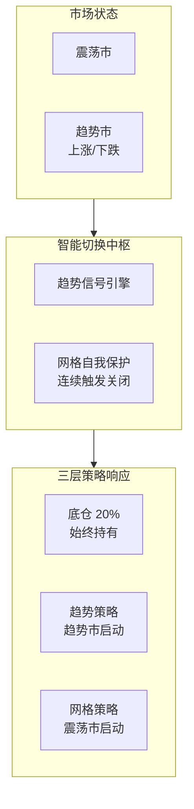
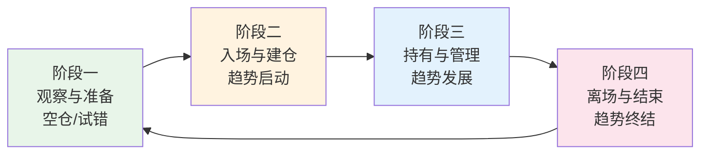
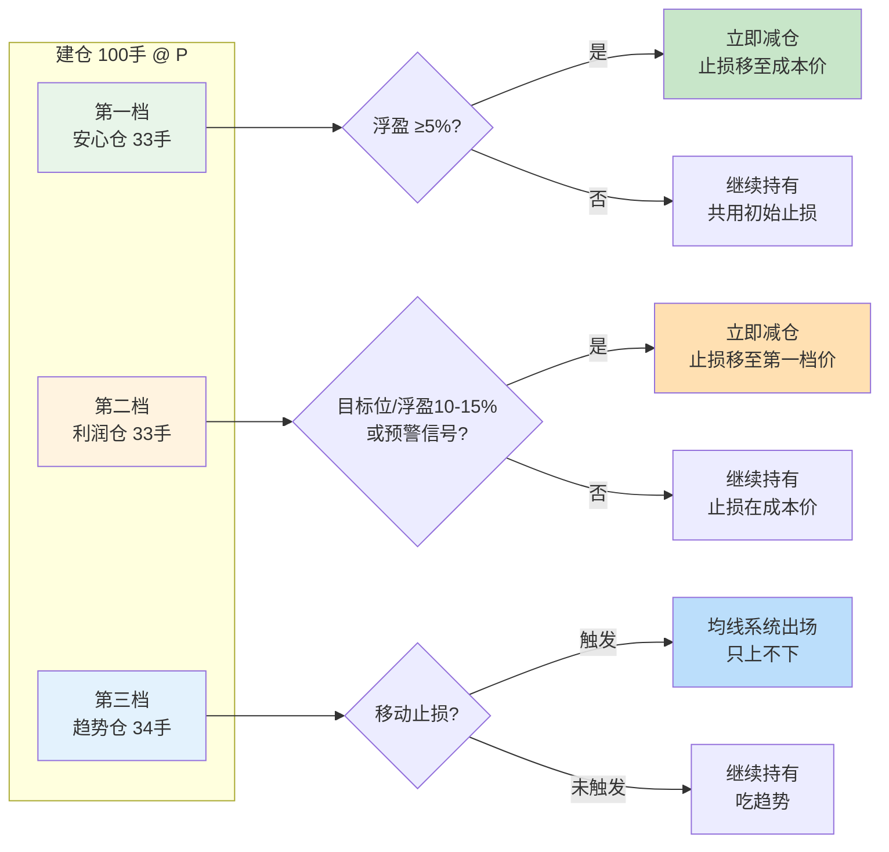
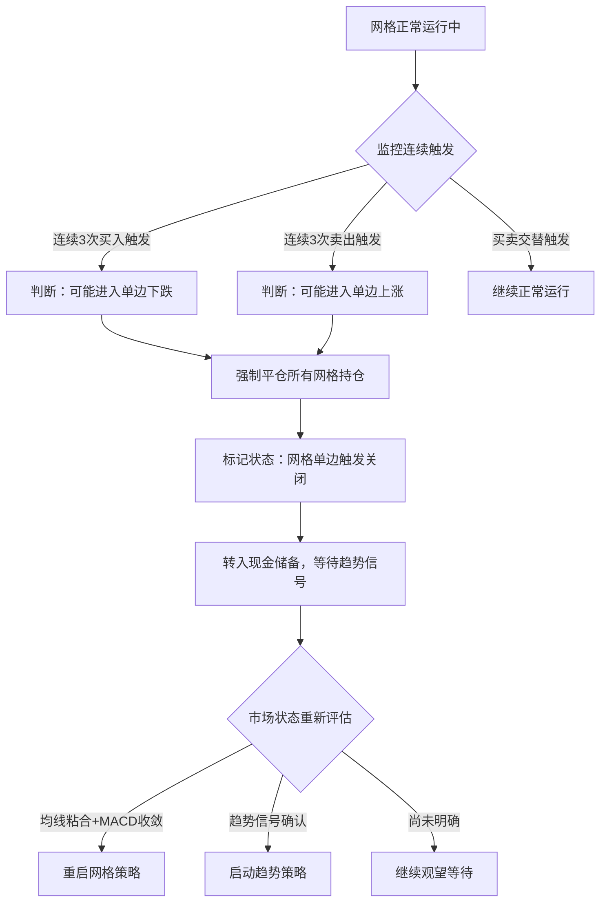

# 当趋势策略遇上震荡市：一套全天候复合交易系统的设计手记

做过一段时间交易的人大概都有过这样的经历：

你精心研究了一套趋势跟踪策略，回测数据漂亮得让人兴奋——年化收益 40%，最大回撤可控，夏普比率超过 2。然后你满怀信心地实盘运行，结果发现：**震荡市里它被反复止损割肉**，好不容易等来一波趋势，前面的利润已经亏掉大半。

反过来，如果你用网格交易在震荡市里收割差价，看似稳定盈利，结果一根大阳线或者一根大阴线打过来——要么踏空起飞的行情，要么被深套动弹不得。

这就是单一策略的宿命：**每种策略都有它的舒适区，也都有它的死穴**。

那有没有可能，让不同策略各司其职，在它们各自擅长的领域里发挥作用？

<!-- more -->

!!! note "本文的实测后续"
    本文是**设计手记**，写于回测之前，自己承认"尚未提供量化回测数据"。2026-10 的两篇实测把它的核心断言逐条测过了，判定如下（被改判的断言已在文中就地改写，不再单独标注）：

    - 多指标共振更可靠 —— 半对：异源双确认有效，同源确认是冗余
    - 大周期定方向 —— 证伪（趋势侧 -112pp），装在网格准入上反而正贡献
    - 顶背离当减仓预警 —— 对：属于仓位管理，不属于买卖点
    - 三档止盈多赚 71% —— 数字错、结构对：是**风险压缩器**，且必须配冷却协议
    - 三层全天候切换 —— 长熊未兑现，跑输纯趋势 16.5pp
    - 信号能压回撤 —— 改判：回撤更浅是"在场时间少"的机械结果，不是信号的功劳

    实测篇：[信号层](../10/21.md) · [仓位层](../10/21-1.md) · [对照实验](../10/24-1.md)。

## 从痛点出发：为什么需要复合系统

### 单一策略的两难困境

先说趋势跟踪策略。它的逻辑很清晰：**截断亏损，让利润奔跑**。当市场出现明确的上涨或下跌趋势时，它能捕捉到大部分行情。但问题在于——**震荡市是趋势策略的噩梦**：价格上上下下，每次看起来像要突破都只是假突破，止损一次接一次。等到真正的趋势终于来了，账户已经伤痕累累。

再说网格交易策略。它的核心思想是**"跌买涨卖"**，在价格区间内反复套利。听起来很稳，但**单边行情是网格的克星**：一路上涨就不断卖出直到空仓踏空，一路下跌就不断买入越套越深。更糟糕的是，很多时候你**无法提前判断**当前是震荡还是趋势的起点。

!!! quote "交易的永恒难题"
    市场只有两种状态（震荡和趋势），但没有人能 100% 准确地预判下一刻会进入哪种状态。我们能做的，不是预测市场，而是**设计一个无论市场怎么走都能应对的系统**。

### 三层思路的由来

1. **不管什么市场，始终保持一定仓位在场内** —— 这样至少不会完全踏空大行情
2. **趋势来了就用趋势策略去追** —— 毕竟这是利润的主要来源
3. **震荡了就切到网格策略去磨** —— 虽然单笔利润小，但胜率高、频率高

这就是本系统的核心理念：**不是预测市场，而是适应市场**。

## 系统总览：三层架构如何协同工作

| 策略层级 | 资金比例 | 定位 | 核心目标 |
|---------|---------|------|---------|
| 战略底仓 | 20% | 压舱石 | 穿越牛熊周期，获取长期复利 |
| 趋势跟踪 | ≤50%（动态） | 主力军 | 捕捉单边趋势行情的大利润 |
| 网格交易 | 50~60%（共享池，动态分配） | 辅助兵 | 震荡市里反复收割小利润 |

这三层不是简单叠加，而是通过**智能切换机制**联动起来：

接下来，我们逐层拆解每条战线的具体规则。

## 第一层：战略底仓——穿越周期的压舱石

很多人做交易的终极恐惧是**踏空**：你精心等待信号，严格控制风险，结果一波大牛市呼啸而过，你全程空仓。这种痛苦比亏钱还难受——亏钱还能总结经验，踏空只能怪自己胆子太小。

20% 战略底仓就是为了解决这个问题的。它是一笔**永久性持仓**，除非触发极端风控条件否则不卖出：即使趋势与网格策略全部判断失误，至少还有 20% 的仓位在享受市场上涨；长期看优质指数年均回报 8%~15%，底仓本身就能贡献 1.6%~3% 的年化。

??? question "底仓应该选什么标的？"

    | 优先级 | 标的类型 | 适合场景 | 风险说明 |
    |-------|---------|---------|---------|
    | **首选** | 宽基指数 ETF（沪深300 / 中证500） | 大多数投资者 | 分散个股风险，长期趋势与经济增长同步 |
    | **次选** | 你长期研究、基本面扎实的优质个股 | 对公司有深度认知 | 个股黑天鹅风险更高，必须配合 30% 回撤保护 |
    | **不推荐** | 完全陌生的个股、概念炒作标的 | — | 底仓不是短线投机工具 |

    **关键原则：底仓标的应与趋势+网格的标的相同。** 这是"三层协同"的隐含前提——如果底仓是 ETF、趋势做个股 A、网格做个股 B，那就是三个互不相关的独立策略，而非"协同系统"。

!!! warning "两条风控红线"

    **个股层面**：从最高点回撤超过 30% 时，减持 50% 底仓。防止个股出现"黑天鹅"式暴跌时损失过大。

    **大盘层面**：沪深 300 跌破年线且年线方向向下时，减仓至 10%。当大盘进入中长期下降通道时，大多数个股很难独善其身。

    两条规则触发后，一旦条件解除（个股反弹或大盘重新站上年线），逐步回补至正常水平。

## 第二层：基于均线-MACD的趋势跟踪系统 V2.1

趋势跟踪策略是整个系统的**"利润发动机"**。但这里要介绍的不是简单的"突破就买、破位就卖"，而是一套**四阶段完整交易框架**——从观察到离场，每一步都有明确的 IF-THEN 规则，旨在实现「**有计划地进场，有纪律地持仓，有规则地离场**」。

### 阶段一：观察与准备（空仓/试错）

阶段一的使命是识别"市场可能要动"的早期迹象，但**不急着入场**：

| 信号类型 | 具体表现 | 含义 |
|---------|---------|------|
| 均线粘合 | MA5、MA10、MA20 高度聚集 | 多空力量暂时平衡，变盘在即 |
| MACD 修复 | DIF 与 DEA 在零轴下方收敛，柱状线缩短或翻绿 | 下跌动能衰竭，正在蓄力 |

最具爆发力的趋势行情往往从 MACD 零轴下方的修复开始——之前的下跌动能已经耗尽，一旦反转，上升空间更大。

这个阶段的本质是**左侧交易**，盈利空间还无法精确定义，因此规则很简单：**主仓位保持空仓**；可动用 ≤5% 资金极小仓位试盘（目的是感受市场温度，不是赚钱）；止损必须极严格，设于震荡箱体下沿，确保单笔亏损 ≤ 总资金 1%。

> 阶段一心法：看得到机会不等于要冲进去。**知道机会来了，但耐心等它确认。**

### 阶段二：入场与建仓（趋势启动）

当阶段一的酝酿终于迎来**右侧确认**时，就是主力部队出动的时刻。入场必须同时满足三个条件，缺一不可：

| # | 条件 | 具体标准 |
|---|------|---------|
| 1 | 价格突破 | 放量（量比 >1.5）突破关键压力位或前期高点 |
| 2 | 均线共振 | MA5 > MA10 > MA20 开始呈现多头排列雏形 |
| 3 | 动能确认 | MACD 在零轴上方或附近形成金叉，红柱放大 |

三个条件的逻辑各有分工：价格突破告诉你方向已经明确；均线共振确认趋势结构已经形成（不是假突破）；MACD 金叉提供动能支撑。只有一个或两个条件符合？**不动**。宁可少做一笔交易，也不要在没有完整证据的情况下入场。

#### 盈亏比门槛：3:1 原则

在计算仓位之前，先回答一个问题：这笔交易**值不值得做**？

$$ \text{盈亏比} = \frac{T - P}{P - S} \geq 3:1 $$

- **P（入场价）**：突破后首次回踩的支撑位，或放量阳线的收盘价
- **S（止损价）**：入场 K 线最低点 或 MA20 价位（取较低者）
- **T（目标价）**：前一波段高点，或下一个强压力位

如果算出来盈亏比不足 3:1，**直接放弃这次交易**——风险收益不对等，长期下来必亏。

#### 仓位计算与执行

$$ \text{开仓股数} = \frac{\text{风险金额}}{P - S} $$

1. 确定单笔风险额：通常为总资金的 **1%~2%**（小资金账户可适当放宽至 3%~5%，但不宜超过 5%）
2. 计算可买股数：风险金额 ÷（入场价 - 止损价）
3. 执行建仓：买入计算得到的股数（通常为计划仓位的 30%~50%，留余力给后续加仓）
4. **立即设置止损单**于 S 价 —— 这一步不能省

!!! note "关于"总资金"的说明"

    公式中的"总资金"指你的**全部账户资产**（含底仓 20% 的市值），风险百分比基于全部资产计算。但实际建仓所需的现金来自**共享池**（总资金的 50%~60%），计算出的仓位金额不能超过共享池上限。若超限，应降低风险百分比或选择价差更小的标的。

举例（100 万账户）：单笔风险限额 2%（2 万元），入场价 P=42.5，止损价 S=40，则股数 = 20,000 ÷ 2.5 = **8,000 股**，开仓资金 34 万元（34% 仓位），最大亏损锁定 2 万元。

无论资金大小，核心原则不变：**每一笔交易的最大亏损都是预先锁定的**。

### 阶段三：持有与管理（趋势发展）

入场只是开始，真正决定胜负的是持仓过程中的管理能力。这一阶段的目标是：**让利润奔跑，同时保护浮盈**。

#### 三类信号及其含义

| 信号类型 | 具体表现 | 应对思路 |
|---------|---------|---------|
| **持仓信号** | 股价在 MA10 上方运行，均线呈多头排列 | 安心持有，不做多余操作 |
| **预警信号** | 股价乖离率 >15%，或出现 MACD 顶背离 | 开始警惕，准备减仓 |
| **加仓信号** | 缩量回踩 MA10 或 MA20 后再度起涨 | 可考虑加仓，但需独立设止损 |

> 为什么要减仓而不是全部清仓？预警信号意味着趋势可能减弱，但未必结束。减仓 1/3 到 1/2 是折中方案：既锁定了一部分利润，又保留了仓位以防趋势继续延伸。**贪婪和恐惧之间的平衡点，就在这里。**

#### 三档阶梯止盈策略（V2.1 增强）

上面"减仓 1/3 到 1/2"是原则性的，实际执行中容易犹豫——减多少？什么时候减？为了解决这个"执行模糊性"问题，引入**三档阶梯止盈策略**，将持仓从建仓那一刻起就拆分为三个独立管理的部分。

**核心思想**：把一笔仓位按 33% / 33% / 34% 拆成三份，每份有独立的出场规则，互不干扰。既能落袋为安，又能让利润奔跑。

**各档规则一览：**

| 档位 | 仓位占比 | 出场条件 | 减仓后止损 |
|------|---------|---------|-----------|
| **第一档：安心仓** | 33%（向上取整） | 浮盈达到 **≥5%** 即减仓，不等待 | 上移至**成本价**——此后这笔交易已不可能亏钱 |
| **第二档：利润仓** | 33%（向下取整） | 满足任一即减：① 到达第一目标位（前高/关键阻力）② 浮盈达 **10%~15%** ③ 出现预警信号（顶背离 / 乖离率 >15%） | 上移至**第一档减仓价** |
| **第三档：趋势仓** | ~34%（含取整余量） | **不设主动止盈目标**，完全依赖均线移动止损 | 见下方移动止损表；如遇翻倍行情，这 ~1/3 仓位能吃到大部分利润 |

**第三档的均线移动止损规则**（根据浮盈幅度逐步收紧）：

| 浮盈幅度 | 移动止损位置 | 背后逻辑 |
|---------|-------------|---------|
| <10%（第一档未减时） | 保持初始止损 S 不变 | 趋势初期波动大，给予足够空间 |
| <10%（第一档已减后） | 上移至 **MA20** | 已有安全垫，用中期均线保护 |
| 10% ~ 20% | 上移至短期生命线 **MA10** | 利润已值得守护，收紧保护范围 |
| >20% 或趋势加速 | 上移至更陡峭的 **MA5** 或最近一根大阳线底部 | 紧跟价格，最大化利润捕获 |
| 出现预警信号 | 切换至小级别上升趋势线 | 用更敏感的参考系应对可能的转折 |

!!! danger "移动止损的核心原则：只上不下"

    止损位一旦上移，**永远不往下调**。哪怕当天股价大幅低开导致触及止损，也要无条件执行离场。这就是"截断亏损"的具体实现——不是预测会跌，而是接受"当前走势已不符合预期"的事实。

**止损位随减仓级联上移**：

| 节点 | 动作 | 剩余仓位 | 止损位置 |
|-----|------|---------|---------|
| 建仓完成 | — | 100% | 初始止损 S |
| 第一档减仓（+5%） | 减 33% | ~67% | 上移至成本价 P |
| 第二档减仓（目标位/预警） | 减 33% | ~34% | 上移至第一档减仓价 |
| 第三档触发 | 均线移动止损 | 0% | 全部离场 |

这种级联机制确保了：**越往后，剩余仓位的安全垫越厚，越敢于拿住**。

!!! warning "止损不分级：一次触发，剩余全平"
    上面这条级联路径走的是「先止盈、后止损」的理想顺序——实盘里更常见的另一种情况是：初始止损 S 在**任何一档减仓之前**就被击穿（建仓次日就打到 S 并不罕见，因为 S = min(入场日 low, MA20) 往往离入场价只有 3~5%）。

    此时**剩余全部在场档位按同一个 S 价一次性平仓**——三档的出场价完全相同是正常现象，不是分批失效。判断规则只有一句：**分批减仓只发生在止盈端**（+5%、+10% 触发的主动减仓）；**止损是账户级风控动作，不分级、不留仓**。跳空低开时按开盘价成交，实际亏损会大于 S。

三档策略适合趋势行情（突破后持续上涨）、三信号共振入场、持仓周期 > 3 天；不适合窄幅震荡市（来回扫止损）、超短线日内交易、打板次日必卖模式。

#### 回调、反转与回补的完整协议

阶段三最常遇到的困惑是：**价格从高点回落了，这到底是正常回调还是趋势反转？** 判断错了，要么被洗出去错失大行情，要么利润全吐回去。

> **核心理念：不预测，只应对。假设它是反转，直到证据证明它只是回调。**

这笔账不需要计算器也能算清楚：

| 选择 | 成本 | 后果 |
|------|------|------|
| 先按反转离场，事后发现只是回调 | **手续费 + 滑点（< 1%）** | 通过下方的「回补协议」可以低成本买回 |
| 死扛不动，结果真的是反转 | **本金亏损（5% ~ 20%+）** | 利润大幅回吐甚至转盈为亏，心态崩塌导致后续操作变形 |

所以规则只有一句话：**出场条件触发 → 按反转处理离场 → 如果证据表明只是回调 → 按回补协议买回来。** 好消息是——三档策略本身就是这套规则的兜底：第一档已在 +5% 减掉，心态上已经不亏；第二档已在目标位减掉，大部分利润锁定；第三档靠移动止损，不需要主观判断，均线说了算。**卖错不心疼，扛错受不了。剩下的就是执行纪律。**

**回补协议**（"卖错了可以买回来"的可执行规则）：触发前提为已经因出场条件触发而离场，且离场原因属于**误判**——即价格随后重新走强。四项条件必须同时达标：

| 条件 | 具体标准 |
|------|---------|
| 一、信号重新确认 | 收盘价重新站稳 **MA10**（若原离场原因是跌破 MA20，则需站回 MA20）+ 反弹过程温和放量且下跌过程为缩量 + MACD 绿柱缩短或翻红 + 至少 1 根阳线收盘价站稳关键均线之上 |
| 二、确认周期 | **收盘价**站稳才算数，盘中站回不计入；离场后至少等 **1 个完整交易日**再评估（避免当日 V 型诱多）；建议离场后 **1~3 个交易日内**完成评估，超 3 天未达标则视为趋势已变 |
| 三、价格上限 | `回补上限 = min(卖出价 × 1.05, 近 5 日 MA20 均值)`——5% 容忍度覆盖绝大多数"洗盘→拉回"场景（通常 3%~8%），排除"卖完后直接拉升 10%+" |
| 四、档位归属 | 回补仓位**统一归入第三档（趋势仓）**，不再重新拆分三档，止损设在本次回补价下方均线位（MA10 或 MA20）——趋势延续性尚未充分验证，不应给予第一/二档的高权重 |

回补是一次**新的资金投入决策**，标准应高于"判断是否离场"：四项必须 AND 全达标，缺一不可。

> **纪律的本质就是：宁可错过一次回补，也不要把"回补"变成"追涨"的借口。**

### 阶段四：离场与结束（趋势终结）

所有趋势都会结束。问题不在于是否结束，而在于你**是否有纪律在它结束时果断离开**。

| 离场类型 | 触发信号 | 执行方式 |
|---------|---------|---------|
| **主动离场** | 达到终极目标位；多次顶背离；长上影线等滞涨 K 线组合 | 分批清仓（如第一目标卖一半，第二目标再卖一半） |
| **被动离场** | 股价触及移动止盈位（跟踪止损） | **立即无条件清仓当前剩余持仓** |
| **失败离场** | 入场后未涨反跌，触发初始止损 S | **立即止损，无条件接受小额亏损** |

!!! important "三种离场的纪律要求"

    - **主动离场**：可以分批（如三档策略中的分档减仓），给自己留一点余地
    - **被动离场**：必须清仓当前剩余的全部持仓，不得抱有"再等等"的幻想
    - **失败离场**：最难但最重要的一步——承认这次判断错了，止损走人，等待下一次机会

#### 假突破的连续处理规则

趋势策略最常见的挫折是：入场信号发出、建仓完成，第二天就被止损——这就是"假突破"。单次假突破不可怕，可怕的是**连续假突破后情绪失控重仓报复**。

| 连续假突破次数 | 动作 | 目的 |
|:---:|---|---|
| 第 1 次 | 正常止损离场，记录原因 | 单次假突破是正常现象，无须反应过度 |
| 第 2 次 | 止损离场，**观察期延长 1 倍**（原 3 天→6 天） | 两次连续失败说明当前市场结构可能不稳定 |
| 第 3 次 | 止损离场，**暂停该标的交易 2 周**，期间只观察不操作 | 三次连续假突破是高概率危险信号 |
| 第 4 次及以上 | 暂停交易 1 个月，**全面复盘**参数（波动率区间、均线周期、盈亏比阈值） | 系统级的持续失败意味着需要重新审视整个策略参数 |

> 连续失败计数器在以下情况归零：(1) 一次成功的趋势交易完成后；(2) 市场信号完全消失（无入场条件）超过 2 周；(3) 重启前完成了复盘与参数调整。

这个规则的核心目的不是"防范假突破"——假突破无法防范。它的目的是**防止你在连续亏损后心态崩溃，用更大仓位去"翻本"**。实测证明它同时也是真金白银的收益：在 562500 五年窗口上，三档止盈补上这套冷却协议后多赚 **33.5 个百分点**，详见[仓位层实测](../10/21-1.md)。

### 为什么这套框架有效

这套 V2.1 系统的本质是将复杂的分析简化为清晰的 **IF-THEN（如果-那么）规则**：

- **IF** 均线粘合 + MACD 修复 → THEN 保持空仓或极轻仓试盘
- **IF** 三信号共振 + 盈亏比 ≥3:1 → THEN 按风控公式建仓
- **IF** 浮盈扩大到某阈值 → THEN 对应地上移止损位
- **IF** 触及任何止损位 → THEN 无条件离场

它不能保证每次都盈利，但能确保你**永远不犯大错**，并在趋势行情中牢牢抓住利润。而成功的执行，完全依赖于你在实战中摒弃情绪、恪守纪律。

## 第三层：网格交易——震荡市的收割工具

如果说趋势策略是猎捕大象的重型武器，那网格策略就是在池塘里网鱼的细密渔网。它在**价格区间内反复低吸高抛**，靠高频次的小利润累积收益。

### 启动条件与市场判断

网格策略的核心前提：**只在震荡市运行，趋势市必须切换到趋势策略**。错误地在趋势行情中开网格，是新手亏损的头号原因。

但这里有一个关键陷阱：**第二层趋势系统"无信号"，绝不等于当前就是震荡市**。趋势系统只负责识别买点和卖点，它沉默时，市场可能处于三种完全不同的状态：

| 趋势系统状态 | 实际市场情况 | 能否开网格？ |
|------------|-------------|-----------|
| 无信号 | 单边上涨中（涨太多，不在买点范围内） | ❌ 绝对不行 |
| 无信号 | 单边下跌中（跌太狠，不符合入场条件） | ❌ 绝对不行 |
| 已离场且无新信号 | 价格横盘区间内来回波动 | ✅ 可以启动 |

因此，网格的启动必须通过**两道独立检查**，缺一不可：

**第一道门：趋势系统空闲确认** —— 趋势策略无持仓（之前仓位已全部离场），且无有效入场信号（阶段一观察条件未满足，或三信号未共振，或盈亏比不够）。只有趋势系统确实"没事可做"时，才轮到考虑网格。

**第二道门：独立震荡验证（核心防错机制）** —— 趋势空闲只是前提，还必须用独立指标证明当前确实是震荡而非单边：

| 验证指标 | 震荡判定标准 | 排除的单边场景 |
|---------|------------|--------------|
| 均线排列 | MA20 与 MA60 走平或粘合（差值 < 3%） | 排除向上/向下发散的趋势行情 |
| 趋势强度 | ADX < 25 且未持续上升 | 排除 ADX > 35 的强趋势加速阶段 |
| 价格位置 | 在近期高低点构成的区间内运行 | 排除突破新高/新低的破位行情 |

!!! warning "两道门的关系"

    **第一道门是"资格检查"，第二道门是"安全验证"**。

    - 只过第一道不过第二道 → 趋势空闲但市场仍在单边 → **观望等待，不开网格**
    - 两道都通过 → 确认震荡市 → **正式启动网格**
    - 任何时刻第二道门的条件被打破（如价格突破区间上沿）→ **立即触发网格保护机制关闭**

### 基本参数设置

#### 斐波那契递增网格（核心设计）

传统网格使用固定间距（如每格 2%），但这忽略了一个关键事实：**价格越深跌，趋势化的概率越大**。固定间距在深位会过早耗尽子弹。本系统采用**斐波那契递增间距**——浅层密集捕捉高频震荡利润，深层稀疏保留资金安全垫。

**买入网格（下跌方向）**，基准价 100 元：

| 档位 | 累计跌幅 | 单档间距 | 间距比例来源 | 触发价 |
|------|---------|---------|-------------|-------|
| 第1档 | -1.0% | 1.0% | — | 99.0 |
| 第2档 | -2.0% | 1.0% | fib(1) | 98.0 |
| 第3档 | -3.5% | 1.5% | fib(1)+fib(0.5) | 96.5 |
| 第4档 | -5.5% | 2.0% | fib(2) | 94.5 |
| 第5档 | -8.5% | 3.0% | fib(3) | 91.5 |
| 第6档 | -13.5% | 5.0% | fib(5) | 86.5 |
| 第7档 | -21.5% | 8.0% | fib(8) | 78.5 |
| 第8档 | -34.5% | 13.0% | fib(13) | 65.5 |

**卖出网格（上涨方向）**采用对称的斐波那契递增间距——越涨越疏，解决两个问题：**避免卖飞** + **自然衔接趋势策略**：

| 档位 | 累计涨幅 | 单档间距 | 设计意图 |
|------|---------|---------|---------|
| 第1档 | +1.0% | 1.0% | 震荡区间密集收割 |
| 第2档 | +2.0% | 1.0% | 震荡区间密集收割 |
| 第3档 | +3.5% | 1.5% | 过渡：开始放慢卖出节奏 |
| 第4档 | +5.5% | 2.0% | 过渡：给上涨留更多空间 |
| 第5档 | +8.5% | 3.0% | 趋势确认区：稀疏卖出，保留筹码 |
| 第6档 | +13.5% | 5.0% | 强趋势：仅减少量仓位 |
| 第7档 | +21.5% | 8.0% | 超强趋势 → 剩余仓位移交趋势策略 |

**关键洞察**：深层间距越大 → 触发概率越低 → 等效于"自动保留筹码"，不需要人工判断"该不该卖"——间距本身替你做了决策。买入方向"越跌越疏"（保留子弹，防止抄底抄在半山腰）与卖出方向"越涨越疏"（保留筹码，防止卖在趋势起点）形成**对称设计**。

!!! success "网格 → 趋势的无缝衔接"

    当卖出触发到**第 5 档（+8.5%）以上**时，斐波那契间距已经足够大（5%/8%），这意味着：剩余仓位几乎不会被网格触发卖出（需要再涨 5%+ 才会触发下一档）；此时价格已走出明显趋势，自然满足趋势策略的入场条件；将剩余持仓转入**趋势策略的第三档（趋势仓）**，后续按均线移动止损跟踪。

    **不存在"切换"的断裂感**——斐波那契间距递增本身就让网格在深层自动"退场"，趋势策略自然"接管"。网格擅长震荡收割，不要让它去做趋势的事。

#### 基准价与其他参数

| 参数 | 设定值 | 说明 |
|-----|-------|------|
| 基准价初始值 | 网格启动时的当前价格 | 所有档位的百分比均相对于此价格计算 |
| 基准价更新规则 | 每次卖出后更新为卖出成交价 | 防止基准价与市场脱节 |
| 止损卖出阈值 | 基准价下跌 1% | 盘中急跌保护（独立于网格档位） |
| 连续同向触发关闭 | 3 次 | 见下方保护机制 |

> 基准价更可靠的取法是**最近 20 个交易日的价格均值（≈MA20）**，代表近期市场的"共识成本"；同时验证当前价格与 MA20 的偏差不超过 ±3%，超出说明可能已脱离震荡，不应启动网格。

> 如果交易的是波动率稳定的宽基 ETF（如沪深300ETF），固定 2% 也完全可用。斐波那契递增更适合**个股**——个股日常震荡通常 1%~3%，但一旦趋势化可以轻松跌 10%+。

### 网格自我保护机制（核心创新）

传统网格交易最大的痛点之一就是**不知道何时该停下来**。价格一直跌就一直买，买到没钱为止；价格一直涨就一直卖，卖到空仓为止。本系统的解决方案是引入**"连续触发自动关闭"机制**：

!!! danger "为什么是三次？"

    连续同向触发三次意味着市场已经走出了一段明显的单边行情。在斐波那契网格中，连续三次买入意味着价格已经从基准点下跌了 **3.5%**（1%+1%+1.5%），这已经触及普通震荡的边界。如果继续触发第 4、5 档（间距扩大到 2%、3%），说明趋势已经确立——此时继续用网格策略对抗趋势，无异于螳臂当车。

    **恢复条件同样严格**：必须等均线重新粘合 + MACD 收敛到零轴附近，确认市场回到震荡状态后才能重启网格。这避免了在"假震荡"中反复受伤。

### 网格仓位管理

网格策略的资金来自**活跃策略共享池（以下简称共享池）**，与趋势策略共用同一笔可动用资金。由于趋势与网格互斥运行，不存在同时占用的情况，因此不需要预先拆分，而是根据当前市场模式**按需分配**：

!!! important "核心原则：一份钱，给当下最需要的策略"

    - 趋势市时，共享池全部归趋势策略使用
    - 震荡市时，共享池全部归网格策略使用
    - 共享池建议上限为总资金的 **50%~60%**

以 100 万资金为例（震荡市模式）：底仓 20 万元固定不动；共享池 50 万元全部分配给网格，分 8 档等额分配（每档 6.25 万元）；价格触发第 1 档（-1%）买入 6.25 万元，以此类推，间距按斐波那契递增；卖出时按对应档位触发，每次卖出更新基准价；深层档位（6~8）极少触发——等同于预留安全垫。资金量较小时（如 50 万账户）可减少到 6 档，砍掉极端的 7~8 档，确保每档金额不至于太薄。

## 三层资金的动态调配机制

理解了各层策略的规则之后，最关键的问题是：**它们之间如何配合？资金如何在各层之间流转？**

### 四种运行状态

| 状态 | 触发条件 | 资金分布 |
|-----|---------|---------|
| **初始状态** | 系统刚启动 | 底仓 20% + 现金 80%（共享池未激活） |
| **震荡市模式** | 通过两道门确认震荡 | 底仓 20% + 网格 50~60% + 现金 ≥20% |
| **趋势市模式** | 趋势系统检测到明确趋势信号 | 底仓 20% + 趋势 50~60% + 现金 ≥20%（网格持仓立即平仓回收） |
| **观望模式** | 网格连续 3 次同向触发关闭，但趋势信号尚未确认 | 底仓 20% + 现金 ≥80%（共享池暂停分配） |

!!! tip "观望模式的价值"

    很多人不喜欢"空仓等待"，总觉得手里有钱不操作是浪费。实际上，**观望也是一种积极的策略**——它让你避开了不确定性最高的时段，保留了充足的弹药去抓住下一个确定的机会。

### 双重切换信号的优先级

| 优先级 | 信号来源 | 具体内容 | 说明 |
|-------|---------|---------|------|
| 1（最高） | 趋势系统信号 | 趋势启动 / 趋势结束 / 震荡确认 | 基于技术指标的综合性判断 |
| 2 | 网格保护信号 | 连续 3 次同向触发 | 基于实际成交行为的反馈 |

!!! important "冲突处理原则"

    如果两套信号同时发出指令（比如趋势系统说"还是震荡"，但网格已经连续触发了 3 次），**以趋势系统为准**。原因是趋势系统的判断基于更多维度的信息，而网格触发只是一个侧面信号。执行时使用市价平仓，接受合理的滑点成本。

## 风险控制的三道防线

任何交易系统如果不谈风控，都是在耍流氓。本系统设计了三道层层递进的防线：

**第一道：战略层风控（针对 20% 底仓）**

| 触发条件 | 执行动作 | 恢复条件 |
|---------|---------|---------|
| 个股从最高点回撤 >30% | 减持底仓 50% | 个股反弹企稳后逐步回补 |
| 沪深 300 跌破年线且年线向下 | 减仓至 10% | 大盘重上年线后回补 |
| 极端系统性风险 | 可全部清仓 | 风险解除后重建底仓 |

**第二道：策略层风控**

| 策略 | 风控指标 | 限制额度 | 触发后果 |
|------|---------|---------|---------|
| 趋势 | 单笔最大亏损 | ≤总资金 2% | 该笔交易触及止损即离场 |
| 趋势 | 单日最大亏损 | ≤总资金 5% | 当日停止开新仓 |
| 趋势 | 月度最大回撤 | ≤总资金 10% | 当月剩余时间降低仓位或暂停交易 |
| 网格 | 连续同向触发 | 3 次 | 强制平仓所有网格持仓，转入观望模式 |
| 网格 | 单档最大投入 | 共享池总额 ÷ 档数（如 50万÷8 = 6.25万/档） | 资金用尽后停止买入，只执行卖出 |
| 网格 | 网格总浮亏 | ≥共享池的 15% | 提前终止网格，不等到全部档位触发完毕 |
| 网格 | 区间破位 | 价格突破近期震荡区间高低点 | 无论当前持仓状态如何，立即关闭网格 |

**第三道：组合层风控（针对整体账户）**

| 风控指标 | 限制 | 说明 |
|---------|------|------|
| 总仓位上限 | ≤80%（含底仓） | 至少保留 20% 现金应对机会和风险 |
| 单一策略上限 | ≤50% | 防止过度集中某一策略 |
| 现金下限 | ≥20% | 保证流动性，避免满仓被动 |

**极端场景预案**：股灾式暴跌时，底仓触发减仓规则、趋势策略触及移动止损自动离场、网格因连续买入自我保护关闭，最终进入高现金比例（≥80%）安全度过风暴；暴涨暴跌交替时网格频繁触发导致磨损增加，连续 3 次触发后自动关闭，宁可少赚不可大亏；信号打架时趋势信号优先、市价执行，接受少量滑点换取执行确定性。

## 实战推演

理论讲完了，让我们用两个完整案例把整套系统串一遍。

### 案例一：三花智控（002050）——复合系统全流程

假设初始资金 100 万元，标的为三花智控，时间从 2025 年 10 月开始。这个案例重点展示**三层策略的协同切换**过程。

**起点**：底仓 20 万元已建好（约 4400 股 @45 元），现金 80 万元，市场状态为震荡市（均线粘合，MACD 在零轴附近徘徊），股价 45 元。系统处于初始状态，等待第一个明确信号。

**第一幕：震荡开启，网格上场。** 均线高度粘合（MA5=45.2, MA10=45.0, MA20=44.8），MACD 柱状线持续缩短接近零轴，成交量萎缩 40%——判定震荡市。通过两道门检查后共享池激活，以 45 元为基准价启动网格。本案例采用固定 2% 等间距便于直观理解（实际运行建议用斐波那契递增间距）：单档风险额 4,500 元（总资金 0.45%，远低于趋势策略的 2%，因为网格频次更高），每档股数 = 4,500 ÷ (45 × 2%) = **5,000 股**。接下来两周股价在 43.2 ~ 46.8 元区间来回震荡，网格完成 3 轮完整买卖，累计盈利约 **1.35 万元**（扣费后约 1.2 万元）。

**第二幕：风云突变，网格自保。** 第三轮卖出后股价没有反弹，而是连续下行：43.65 元买入第 1 档、42.78 元买入第 2 档，已用尽共享池全部 2 档资金，自我保护机制启动。系统将所有网格持仓（10,000 股 × 42.78 ≈ 42.78 万元市值）全部市价平仓，回收约 41 万元，标记"网格单边触发关闭"，转入观望模式。两次买入累计投入 43.2 万元，平仓回收约 41 万元，直接亏损约 2.2 万元；扣除前三轮盈利 1.3 万元后本阶段净亏约 0.9 万元。可做对比：若不止损继续持有，股价跌到 35 元时账面浮亏将超过 7.8 万元——**自我保护机制的本质是"花小钱买保险"**。

**第三幕：趋势来临，主力出击。** 一周后市场出现变化：成交量放大到前期 2.5 倍（量比 >1.5）、MA5 上穿 MA10 和 MA20 形成多头排列雏形、MACD 在零轴上方金叉红柱放大、股价放量突破 42 元前期平台压力——趋势系统发出"上涨趋势启动"信号。仓位计算 = 1,000,000 × 2% ÷ (42.5 − 40) = **8,000 股**，投入 34 万元（34% 仓位），最大风险 2 万元。

随后三周股价如期走出一波上升趋势，用 V2.1 三档阶梯止盈管理这 8,000 股（2,640 / 2,640 / 2,720 股）：

| 档位 | 买入均价 | 卖出价格 | 股数 | 单笔利润 | 触发原因 |
|-----|---------|---------|------|---------|---------|
| 第一档（安心仓） | 42.5 | 44.6 | 2,640 股 | **+0.55 万元** | 浮盈 +5% |
| 第二档（利润仓） | 42.5 | 47.2 | 2,640 股 | **+1.23 万元** | 浮盈 +11% |
| 第三档（趋势仓） | 42.5 | 48.5 | 2,720 股 | **+1.63 万元** | MA5 移动止损（股价 49.5 遇阻回落） |
| **合计** | — | — | **8,000 股** | **+3.42 万元** | |

推演当时对比旧版单笔管理（全程持有到 45 元止损 = +2.00 万元），得出"三档多赚 +1.42 万元（+71%）"——**这个数字后来被实测推翻了**。它是手工推演的产物，价格路径是构造出来的单边趋势：真实数据里三档在 562500 五年窗口跑输单笔管理 37 个百分点，补上假突破冷却协议后才追平，但回撤只有一半；两个指数 21.8 年全周期上纯移动止损变体夺冠。**三档止盈不是收益增强器，是风险压缩器**——推演之所以漂亮，是因为路径走了单边趋势，而实盘里"扫损 → 追回 → 再扫"的磨损占掉了 33.5pp。详见[仓位层实测](../10/21-1.md)。

**第四幕：回归震荡，循环往复。** 趋势结束后股价在 48 ~ 52 元区间重新整理，均线再次粘合、MACD 回落至零轴附近收敛、成交量萎缩。趋势系统发出"震荡确认"信号，39.6 万元资金回收回共享池，以 50 元为新基准价重启网格。

| 阶段 | 时长 | 主要策略 | 关键事件 | 估算盈亏 |
|-----|------|---------|---------|---------|
| 起点 | — | 底仓建立 | — | 0 |
| 第一幕 | ~2周 | 网格交易 | 震荡市 3 轮套利 | **+1.35 万元** |
| 第二幕 | ~1周 | 网格自保 | 连续触发 2 次，资金用尽后关闭 | 约 -0.9 万元（扣除前期盈利后） |
| 第三幕 | ~3周 | 趋势跟踪（V2.1三档） | 上涨趋势完整捕获 | **+3.42 万元** |
| 第四幕 | 循环中 | 网格重启 | 返回震荡状态 | 待统计 |

可以看到：**利润主要来源于第三幕的趋势行情**。网格在第二幕出现亏损（这是保护机制的代价——用小亏损避免了更大的深套），但第一幕的盈利证明了震荡市中网格策略的价值——让资金在等待趋势的过程中没有完全闲置。

### 案例二：涪陵电力（600452）——V2.1 趋势系统四阶段推演

上一个案例展示了三层策略的协同切换。这个案例聚焦于**第二层趋势策略的完整四阶段流程**，也是实测代码里的锚点用例——三档出场的推演数字被写成了单元测试。

假设总资金 **10 万元**，单笔风险限额 **1.5%（1,500 元）**。

**阶段一：观察与准备。** MA5、MA10、MA20 高度聚集在 12.0 ~ 12.3 元，DIF 与 DEA 在零轴下方收敛、柱状线持续缩短，成交量萎缩。符合阶段一特征——趋势未明，潜在机会存在但方向不确定。行动：**主仓位保持空仓观望，不操作，等待右侧确认信号**。看到均线粘合就忍不住先买进去"埋伏"是这里最常见的亏损来源——**看到了不等于要动手**。

**阶段二：入场与建仓。** 一段时间后放量突破 12.46 元压力位，收盘 12.60 元，量比 >1.5，MA5 开始上穿 MA10 和 MA20，MACD 在零轴附近金叉、红柱放大。

| 参数 | 数值 | 确定依据 |
|-----|------|---------|
| 入场价 P | **12.60 元** | 放量突破后的确认收盘价 |
| 止损价 S | **12.00 元** | 前期平台低点（取较低者） |
| 目标价 T | **14.50 元** | 前期高点区域 |
| 盈亏比 | **3.2:1** ✅ | (14.50−12.60)/(12.60−12.00) = 1.9/0.6 |

可买股数 = 1,500 ÷ (12.60 − 12.00) = **2,500 股**，开仓资金 31,500 元（31.5% 仓位），止损单设于 12.00 元，最大风险 1,500 元。**止损单要在买入的同时就设好**——不要给自己犯错的机会。

**阶段三：持有与管理（三档策略实战）。** 建仓时即拆分三档：第一档安心仓 825 股（33%，向上取整）、第二档利润仓 825 股（33%）、第三档趋势仓 850 股（余量）。

- **上涨至 13.23 元（浮盈刚好 +5.0%）→ 第一档触发。** 卖出 825 股 @13.23，利润 825 × 0.63 = **+520 元**，剩余 1,675 股。**关键动作：止损从 12.00 上移至成本价 12.60**——此后即使最坏情况触发止损，剩余仓位也只是平手。
- **涨至 14.00 元（浮盈 +11.1%）出现顶背离 → 第二档触发。** 股价创新高但 MACD 柱状线未能同步创新高，同时浮盈满足"10%~15%"条件。卖出 825 股 @14.00，利润 **+1,155 元**，剩余 850 股第三档。**关键动作：止损从 12.60 上移至第一档减仓价 13.23**。
- **第三档继续持有，依赖均线移动止损。** 浮盈 10%~20% 区间应上移至 **MA10**（假设当前约 13.50 元）；由于 MA10(13.50) > 当前止损位(13.23)，满足"只上不下"原则，止损进一步上移至 13.50 元。第三档的任务只有一个：**让利润奔跑，直到均线系统说"停"**。

**阶段四：离场与结束。** 股价冲高至 14.50 元后回落，最终触及移动止损位：

| 档位 | 减仓时间 | 减仓价格 | 股数 | 单笔利润 | 触发原因 |
|-----|---------|---------|------|---------|---------|
| 第一档 | 浮盈 5% 时 | 13.23 元 | 825 股 | **+520 元** | 固定百分比触发 |
| 第二档 | 顶背离/浮盈 11% | 14.00 元 | 825 股 | **+1,155 元** | 预警信号 + 目标位 |
| 第三档 | 回落触均线止损 | 13.50 元 | 850 股 | **+765 元** | MA10 移动止损 |
| **合计** | — | — | **2,500 股** | **+2,440 元（+7.7%）** | |

!!! quote "三档策略 vs 传统单笔管理"

    如果采用传统方式（不分档，全程持有到 13.50 元止损离场），总利润为 2,500 × (13.50 − 12.60) = **+2,250 元（+7.1%）**。本例中三档以 +7.7% 对 +7.1% 小胜，但三档真正的优势不只是多赚这 190 元：

    1. **风险暴露不同**：三档在涨到 13.23 元时就已锁定利润并上移止损，之后最大可能亏损远低于传统方式
    2. **心态不同**：第一档减完后"已经不亏了"，能更冷静地持有第三档
    3. **大行情场景**：如果股价不是回落到 13.50，而是一路涨到 18 元呢？第三档 850 股会继续吃到 4.50 元/股，额外获利 **3,825 元**；而传统方式如果中途被小波动洗出去，可能根本拿不到

    三档策略的本质是**用结构化的分批止盈换取确定性和心理优势**。本次案例中小胜，大行情中可能大幅跑赢。

如果触发的是 12.00 元初始止损（入场后直接下跌），则无论分几档都是 **1,500 元（1.5%）** 的亏损——因为还没到第一档触发点，全部仓位一起止损。更重要的是——无论结果是赚 7.7% 还是亏 1.5%，**都在计划之内**。没有恐慌决策，没有情绪化操作，一切按照 IF-THEN 规则执行。这就是系统化交易的意义。

## 日常运维：检查清单与复盘框架

设计好系统只是第一步，真正决定成败的是**日常执行的纪律性**。

**每日必做 —— 市场状态仪表盘**：趋势状态（上涨/下跌/震荡）、网格状态（运行中/已关闭/待启动）、连续触发计数（买入 / 卖出各 0~3）、总仓位、分项明细（底仓 / 趋势 / 网格 / 现金）。

**信号检查清单**：

- [ ] 均线排列状态（多头/空头/粘合）
- [ ] MACD 位置与方向（零轴上/下/附近）
- [ ] 成交量变化（放量/缩量/持平）
- [ ] 网格连续触发计数器归零或累加
- [ ] 各策略资金使用情况和当前回撤
- [ ] 现金储备是否 ≥ 20%

**每周复盘框架**（约 30 分钟）：① **执行一致性检查**——本周是否有该执行而没执行的信号、是否有不该执行而主观介入的操作，诚实记录每一次违规；② **信号质量统计**——发出了几个信号、多少正确多少错误、错误原因是什么；③ **资金曲线分析**——绘制权益曲线，观察回撤与增长节奏是否平滑、有无异常跳变；④ **参数优化评估**——是否有某个参数明显不适应最近的市场环境（注意不要过度优化）；⑤ **市场阶段定位**——当前处于牛熊震荡哪个阶段的什么位置，对后续策略选择有什么启示。

## 总结：系统的精髓与局限

### 这套系统的核心优势

| 优势维度 | 具体表现 |
|---------|---------|
| **全天候适应** | 震荡、上涨、下跌三种市场状态均有对应策略，不存在"盲区" |
| **风险分散** | 三层策略的风险源不同、相关性低，互为对冲 |
| **自动风控** | 网格连续触发保护机制无需人工干预，克服人性弱点 |
| **资金效率** | 不同环境下都有策略在运作，减少资金闲置浪费 |
| **长期稳健** | 20% 底仓确保不会踏空大牛市，享受长期复利 |

上面五条里有两条被实测收窄了，需要如实说明：**"全天候无盲区"**——切换系统在长熊窗口跑输纯趋势 16.5pp，纯网格 -8.4%（两个指数全周期 -1.6% / -2.9%，"网格死于单边"）：盲区不在策略覆盖上，在切换损耗与单边行情里。**"20% 底仓防踏空"**——五年单边下行中底仓是纯拖累（组合 +81.4% < 纯切换 +105.9%），它的价值需要一轮大牛市才能检验。真正被数据支持的是**分层风控压回撤**这一条。

### 必须正视的局限

!!! quote "没有完美的系统"

    任何系统都有自己的适用边界和代价。承认局限比吹嘘优势更重要。

- **切换成本不可避免**：从网格切换到趋势（或反之）的过程中，会有一定的滑点和时机损失。这是"适应市场"的代价
- **震荡转趋势的初期最难熬**：网格刚因连续触发关闭，趋势信号还没确认——这段时间你可能看着价格上涨却只能空仓观望
- **参数需要定期审视**：2% 的网格阈值、共享池 50%~60% 的资金比例、2% 的单笔风险限额——这些都不是放之四海皆准的真理
- **执行力决定一切**：再完美的系统，如果不能严格按信号执行，也只是一堆废纸。人性的贪婪和恐惧是这个系统最大的敌人
- **仅覆盖多头方向**：三层策略全部是多头操作。在大熊市里，即便减仓至 10% 底仓 + 80% 现金，底仓依然在承受下跌。如需覆盖空头方向，需另行设计反向 ETF、期权对冲或趋势做空模块。本文的设计范围明确限定为 A 股市场可执行的多头策略系统

**参数调优需要方法论**：文中的阈值（2% 止损、3:1 盈亏比、30% 底仓回撤、3 次网格关闭）是基于沪深 300、中证 500 等主流宽基标的在正常波动率下的经验值：

| 市场特征 | 止损比例 | 盈亏比门槛 | 网格间距 | 共享池比例 |
|---------|:---:|:---:|:---:|:---:|
| 高波动率标的 | 适当上调（多给空间） | 同步上调（风险补偿） | 同步放大 | 降低（留更多现金） |
| 低波动率标的 | 适当下调 | 同步下调 | 同步缩小 | 可小幅上调 |
| 大牛市 | 保持标准 | 保持标准 | 不适用（趋势优先） | 趋势策略优先 |
| 大熊市 | 收紧 | 上调（好机会更少） | 谨慎启动 | 降低（现金为王） |

核心原则：**一次只调一个参数**，调完观察至少 20 笔交易后再判断是否有改善。同时调整多个参数会让你无法判断哪个变量起了作用。

### 回测已经补上了

本文是"设计手记"，聚焦于系统的逻辑推导和规则制定。2026-10 的两篇实测把当时列的三条"下一步工作"全部做完了：

| 当时的待办 | 实测结果 |
|---|---|
| 年化 / 最大回撤 / 夏普 | 已完成：562500 五年窗口 + 000001/000905 各 21.8 年全周期 + 18 标的横截面 |
| 纯趋势 vs 纯网格 vs 三层复合 | 纯趋势总收益最高（+128.4%）；三档+冷却风险调整登顶（夏普 1.39、卡尔玛 1.66）；纯网格最差（-8.4%，"网格死于单边"）；切换系统跑输纯趋势 16.5pp |
| 不同市场周期拆解 | 结论随行情轮换：全周期上三档排序、零轴与底背离标签全部翻转——跨样本能带走的只有结构，没有数字 |

!!! warning "实盘前请先看这两条改判"
    实测推翻的不是规则，是两条**收益预期与归因**：

    1. **三档止盈的 +71% 不成立**（见上文推演处）——它是风险压缩器，不是收益增强器，且必须配冷却协议才算完整
    2. **"信号能压回撤"的归因不成立**——随机挑时机离场的中位回撤 -40.7%，比信号的 -43.7% 还浅（p_dd 0.448）：回撤更浅属于低暴露的机械结果，不属于信号

    操作规则以[仓位层实测](../10/21-1.md)为准，信号层的证据见[信号层实测](../10/21.md)，归因改判的对照实验见[《信号有没有用？》](../10/24-1.md)。
    要一份每天收盘后照着执行的清单（含速查卡），用[《复合交易系统操作手册》](../10/24-2.md)；代码与命令行版本见
    [GUIDE.md](https://github.com/yiiewang/yiiewang.github.io/blob/master/example/2026/10/21-1/GUIDE.md)。
    本文的规则条文仍然有效，但**切勿直接把文中的推演数值当作实盘参数**。

### 五条执行铁律

1. **严格纪律**：信号触发必须执行，不得因主观判断而犹豫或修改

2. **资金隔离**：三层资金独立计算，严禁混用——网格亏了不能用趋势的钱补，趋势止损不能动底仓

3. **记录完整**：每笔交易都要记录策略来源、信号依据、执行价格、实际滑点和最终盈亏

4. **定期回顾**：每月进行系统级回顾，统计信号准确率、最大回撤、夏普比率等关键指标

5. **接受不完美**：追求的是**长期概率优势**，而非每一笔都完美。完美的系统不存在，稳健的系统才可靠

---

回到开头的问题：为什么我们需要复合系统？

因为市场的本质就是**不确定的**。今天有效的方法明天可能失效，震荡之后可能是趋势，趋势尽头又是震荡。与其试图找到那个"一招鲜"的圣杯，不如老老实实地搭一套**不管市场怎么走都能应对的体系**。

这不是最快的赚钱方式，但或许是最能在市场中**活得久**的方式。

而活得久，本身就是一种竞争优势。

---

*免责声明：本文仅为个人研究和学习记录，不构成任何投资建议。交易有风险，入市需谨慎。*
