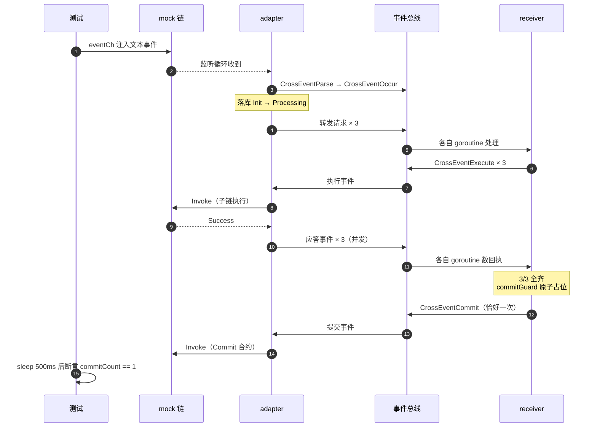

# 一个跨链事件的旅程：3 个子事件，恰好 1 次 Commit

`shard-fusion-sdk-go` 的 `cross` 模块是一个进程内跨链网关：监听链上跨链合约的事件，用事件总线驱动两阶段提交——子链执行（Execute）→ 证明汇总 → 主链提交（Commit）。仓库里的 `cross/ARCHITECTURE.md` 是地图，这篇是行军路线：挑一个最有代表性的场景，从测试代码一路追进网关内部。

我选的场景是 **多个子事件汇聚后恰好 Commit 一次**。它同时踩中两阶段提交的两个命门：汇聚（什么时候算全齐）和幂等（全齐之后怎么保证只发一次）。主线是端到端测试 `TestE2E_MultiSubEvent_CommitOnce`，文中代码全部出自仓库真实文件，跟着路径翻即可。前置阅读：[事件驱动入门：从"A 调 B"到手写一个事件总线](./09-2.md)。

<!-- more -->

## 测试搭台：真实网关，假链

主角只有 40 行：

```go title="cross/cross_e2e_test.go"
// 场景2：多子事件全成功 → 汇聚后仅一次 Commit
func TestE2E_MultiSubEvent_CommitOnce(t *testing.T) {
	gw := newE2EGateway(t, nil)
	defer gw.Stop()

	crossID := fmt.Sprintf("e2e-multi-%d", time.Now().UnixNano())
	// 3 个子事件全部目标 chain1
	gw.emitCrossEvent(crossID, []string{"chain1", "chain1", "chain1"})

	waitFor(t, 10*time.Second, func() bool { return gw.commitCount() >= 1 },
		"all sub events done should trigger exactly one commit")

	// 子事件执行次数：先等一拍让流程收敛，再校验 Commit 不会重复触发
	time.Sleep(500 * time.Millisecond)
	assert.Equal(t, 1, gw.commitCount(), "commit should fire exactly once for all sub events")
}
```

三个断言点撑起全部判断：`waitFor` 以 20ms 一次的轮询对抗异步时序；`commitCount()` 数 mock 链被调了多少次 Commit；最后的 `Equal(t, 1, ...)` 要求的不是"至少一次"，是 **恰好一次**——防重失效导致的第二次 Commit 会被它当场抓住。

舞台由 `newE2EGateway` 搭建，三件事：

1. 注入 mock 链工厂。`adapter.SetChainAdapterFactory` 把适配器构造函数换成测试自己的，网关以为在连真链，实际每个 `adapter` 都是假的。
2. 建隔离网关：独立事件总线 + 独立存储句柄 + 独立资源管理器，测试间互不污染。
3. `gw.Start()` 启动全部 handler，`gw.AddChain(...)` 注册一条叫 `chain1` 的链，带假证书的 TLS/签名/CA 身份（身份与证书的背景见 [长安链 SDK-Go：从跑通到用对](./09-1.md)）。

```go title="cross/cross_e2e_test.go（newE2EGatewayWithHandle 节选）"
// 注入 mock 链工厂：AddChain → ChainResStartOpEvent → createChainAdapter 走 mock
mockAda := injectMockAdapter(t)
rm, err := resource.NewResourceManager(storeHandle)
eventBus := bus.NewHookEventBus()  // 独立事件总线
rt := runtime.NewRuntime(eventBus, storeHandle)
rt.RM = rm                         // 独立资源管理器

gw := newGateway(rt)
require.NoError(t, gw.Start(hooks...))                    // 启动全部 handler
require.NoError(t, gw.AddChain(testChainConfig("chain1"))) // 触发 mock 工厂创建适配器
```

`emitCrossEvent` 把一段文本塞进假链的事件通道，按的是生产同款文本协议：

```text title="buildCrossEventData 构造的文本协议"
CrossID:e2e-multi-...;EventName:crossEvent;Business:e2e-test;
CommitContractName:commit,...,CommitIdentity:sign_identity;   ← 销单时找谁
ChainRID:chain1,Identity:e2e-user,ContractName:sub-contract,...; × 3 ← 3 个子任务
```

只注册了一条链，3 个子任务全打向 `chain1`。汇聚逻辑数的是子事件、不数链，语义照样成立。故事从这里开始。

## 文本变事件：解析与登记造册

假链的 `ConvertToCrossEvents` 不自己发明格式，直接调生产代码 `CrossEventManager.ParseListenEvent` 解析，所以测试里得到的 `CrossEvent`（编号 + 销单合约信息 + 3 个子事件）和真链上的一模一样。网关的监听循环把它包成 `CrossEventParse` 事件异步发布，再经 `CrossEventOccur` 落到 adapter 的 `handleListenData`：

```go title="cross/module/adapter/adapter_handler.go（handleListenData 节选）"
func (h *ChainAdapterHandler) handleListenData(e *types.CrossEvent) {
	err := h.save(e) // ① 落库：主事件 + 3 个子事件，状态 Init，ExecIdx = 0/1/2
	if err != nil {
		h.log.Errorf("save cross[%s] event error : %v", e.CttListenData.CrossID, err)
	} else {
		if err = e.CheckAvailability(h.rm); err != nil { // ② 校验 CommitIdentity
			h.svc.UpdateMajorEventStatusAndMessage(e.CttListenData.CrossID,
				schema.NewEventStatus(schema.CrossEventStatusFailure, err.Error()))
			return // 不可用 → Failure，不进 Execute
		}
		for _, subEvent := range e.CttListenData.SubEvents {
			h.handleSubEvent(e, subEvent) // ③ 逐个发布"转发请求"事件
		}
		h.svc.UpdateMajorEventStatusAndMessage(e.CttListenData.CrossID,
			schema.NewEventStatus(schema.CrossEventStatusProcessing, "")) // ④ 主事件置 Processing
	}
}
```

四步里有两个值得停一下的细节。`ExecIdx` 在模型转换时按出现顺序分配（`for idx, subEvent := range subEvents { subEvent.ExecIdx = idx }`），它是后面数回执的编号系统；`CheckAvailability` 校验 `CommitIdentity:sign_identity` 是不是 `chain1` 上注册过的签名身份——不是的话整个事件直接置 `Failure`，连 Execute 的门都摸不到。

!!! note "为什么先落库再校验"

    校验失败的 `Failure` 状态也得有地方写，所以落库在前。状态机 Init → Processing → Complete | Failure，每一步都落库——这是贯穿整个网关的第二条主线：状态流。

## 第一阶段：Execute 与应答回流

receiver 收到"转发请求"（`TransferRequestReceiveOpEvent`），`handleRequest` 做三件事：

1. **验证**：请求附带的源交易证明。当前代码走 `LocalTrustProver` 直通——直接返回成功；真环境这条路径是 SPV 验证，代码保留未启用。
2. 更新该子事件的证明状态（落库）。
3. 把证明数据塞进第一个参数，构造 `CrossExecuteEvent`（带目标合约、参数、`ExecIdx`），异步发布到总线。

adapter 收到 Execute 事件，调假链的 `Invoke`。假链做两件事，这是测试的 **观测点**：

```go title="cross/cross_e2e_test.go"
func (m *mockChainAdapter) Invoke(e event.Event) (*adapter_types.InvokeContext, error) {
	m.mu.Lock()
	m.invokes = append(m.invokes, fmt.Sprintf("%d", e.Type())) // ① 记录"链被调了什么"
	m.mu.Unlock()
	if m.invokeFn != nil {
		return m.invokeFn(e)
	}
	return adapter_types.NewInvokeContext( // ② 返回成功
		fmt.Sprintf("mock-tx-%d", time.Now().UnixNano()),
		"mock invoke ok", schema.ContractStatusSuccess), nil
}
```

然后 adapter 把执行结果（连同 `ExecIdx`、交易信息）包成应答事件 `TransferResponseReceiveOpEvent` 发回总线——注意执行 **失败也会发应答**，只是状态是 Failure。3 个子任务会独立走到这里 3 次。

## 数回执：汇聚与防重

receiver 的 `handleResponse` 是整个网关最要紧的逻辑：

```go title="cross/module/receiver/receiver.go（handleResponse 节选）"
// 更新这个子事件的证明状态（落库）
err = r.svc.UpdateSubEventStxProveData(ctre.CrossID, ctre.ExecIdx, stxProveCtx)
// 从库里重新捞出全部 3 个子事件
dbCrossSubEvents, err := r.svc.GetCrossSubEventsByCrossID(ctre.CrossID)
// ...
for _, subEvent := range dbCrossSubEvents {
	if subEvent.ExecuteIdx == ctre.ExecIdx {
		// 当前处理的子事件：证明用内存里的值，不依赖库（源码注释标了 [IMPORTANT]）
		if txProveCtx.VerifyStatus > schema.ProveStatusUnknown {
			chainTxContexts.Append(/* ... */)
		}
	} else if subEvent.StxProveStatus > schema.ProveStatusUnknown {
		// 其他子事件：从库里数——判断是否处理完，不关心是否成功
		chainTxContexts.Append(/* ... */)
	}
}
if chainTxContexts.Len() == len(dbCrossSubEvents) {
	// 全齐 → 触发 Commit（有防重，见下）
}
```

**3 个应答是并发到达的**。总线的消费循环给每个事件起独立 goroutine，任何一个应答都可能当"最后一个"。数数逻辑里还有个细节：当前处理的子事件，证明状态用内存里的值，其他子事件从库里读——源码注释标着 `[IMPORTANT]`，防的是自身落库可见性问题导致误判。

于是竞态来了。汇聚判断是典型的 check-then-act：

- goroutine A（应答 0）：写完 0 的证明 → 读库，看到 1、2 都已落库 → 3/3，全齐
- goroutine B（应答 1）：写完 1 的证明 → 读库，看到 0、2 都已落库 → 3/3，也全齐

两个 check 都赶在对方 act 之前完成，就都去发 Commit。没有防重的话，主链会被销两次单。修法是 `commitGuard`——一个 `sync.Map`，把"发布权"的争夺变成一次原子操作：

```go title="cross/module/receiver/receiver.go"
// commitGuard 防止并发应答同时满足汇聚条件导致重复发布 Commit
// （多个子事件应答并发处理时，各自把自己计入内存中的证明上下文，
//   可能同时通过"全部完成"判断——LoadOrStore 保证只发布一次）
commitGuard sync.Map // crossID -> struct{}{}

// handleResponse 末尾：
if chainTxContexts.Len() == len(dbCrossSubEvents) {
	// 并发应答防重：原子占位，已发布过 Commit 的事件直接返回
	if _, loaded := r.commitGuard.LoadOrStore(ctre.CrossID, struct{}{}); loaded {
		r.log.Infof("commit for cross[%s] has already been published, skip duplicated trigger", ctre.CrossID)
		return nil
	}
	// 构造 CrossCommitEvent，发布到总线
}
```

谁先占上 `crossID` 这个坑谁发，其余直接跳过——**Commit 恰好一次**，这正是本测试要验证的东西。

!!! warning "竞态是概率性的"

    我做了次变异验证：删掉 `LoadOrStore` 那两行，`-count=10` 连跑 10 次，挂了 1 次；补测的 20 连跑又全绿。这就是并发 bug 的阴险之处——本地永远绿，生产高峰期偶发双倍 Commit。测试里 `waitFor` 之后的 `time.Sleep(500 * time.Millisecond)` 就是在给"迟到的重复 Commit"留落地窗口，`Equal(t, 1, ...)` 才有机会抓它。

顺带一个容易误解的语义：**失败也会 Commit**。汇聚条件是"所有子事件应答均到达"，数的是证明状态 `> Unknown`，不是成功状态——失败信息随证明数据一并提交，终态由主链 Commit 合约裁决。这是"如实上报"，不是"失败就中止"。

## 第二阶段：Commit 与收网

receiver 从库里捞主事件，把汇总的证明数据 base64 后塞进合约参数，构造 `CrossCommitEvent`（销单合约 + 参数）发布。adapter 收到后再次 `Invoke` 假链——**这就是 `commitCount()` 数的东西**。

假链记下这次调用，adapter 随后更新主事件状态（Complete 或 Failure），并把事件记录从库里删除（`updateCommitInfo` → `DeleteCrossEvent`）。销单完成，账本清零。

!!! tip "想观测跨链状态？用 Hook"

    Commit 后事件记录就没了，事后查库查不到。SDK 的标准姿势是注册一个挂在 `CrossEventCommit` 前置点的 Hook，在 Commit 触发瞬间抓状态快照——同文件的 `commitSnapHook` 就是现成范例。

收网的最后一击回到开头那段测试代码：`waitFor` 轮询解决"什么时候到"，`sleep 500ms` 解决"会不会有第二个"，`Equal(t, 1, ...)` 下最后判决。

## 小结

一张图收下全程：



两条主线贯穿始终：**控制流**——事件在总线上流转，adapter 和 receiver 互不知道对方存在，全靠 OpEvent 解耦；**状态流**——每一步都落库，Init → Processing → Complete/Failure → 删除，崩溃后靠 `DoRecovery` 重放未完成的事件。测试的两只眼睛，一只盯链侧调用记录（`m.invokes`），一只盯库里的状态。

汇聚与防重这对矛盾在分布式事务里反复出现：数回执是 check，发 Commit 是 act，中间没有原子性就是竞态窗口。`sync.Map` 的 `LoadOrStore` 一行代码把窗口焊死——简单，但得先有人踩过坑，才知道要焊的是这里。

---

*最后更新：2026-10-12*
