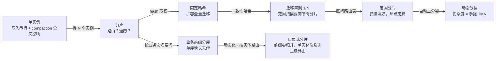

# 拆库记：LevelDB 分片演进，每一步都是为了解决什么问题

单个 LevelDB 装不下了，或者写不动了，标准答案是分片（sharding）：一个进程里开 N 个实例，把 key 拆开放。但拆库不是一刀下去就完事——每拆一刀，都会冒出新的问题，逼你做下一个决定。这篇按“问题 → 解决 → 新问题”的链条，把整条演进路从头走一遍，不需要任何前置知识。

<!-- more -->

先从 LevelDB 长什么样说起。

## 1. 起点：单个 LevelDB 的两个瓶颈

LevelDB 是 Google 出品的嵌入式 KV 存储，Go 生态里的事实标准实现是 [goleveldb](https://github.com/syndtr/goleveldb)（纯 Go、无 CGO）。它的底层结构叫 **LSM 树**，工作方式可以概括成一条流水线：

1. 写入先进内存的 **memtable**，攒着
2. memtable 满了 → 冻结成不可变的一份，同时开一个新的继续接写入
3. 冻结的 memtable 落盘成一个 **SST 文件**——内部按 key 排好序
4. SST 文件越堆越多，后台的 **compaction** 持续把小文件归并成大文件

!!! tip

    一句话：LSM 用“先写内存、攒批落盘”换来极高的写入吞吐，代价是读的时候要多查几个地方，以及后台永远有整理工作要做。

代价兑现成两个瓶颈：

- **写入串行化**。LevelDB 是单写队列，所有写操作在一个队列里排队，吞吐上限被单实例锁死
- **compaction 全局影响**。后台整理是全局的，一个实例 compaction 抖起来，整个库所有数据的读写延迟跟着抖

数据量涨上来之后，这两个都不是调参数能救的——是结构性的。

顺带回答一个“为什么不直接用现成产品”：考古了一圈，[SSDB](https://github.com/ideawu/ssdb) 停止维护，[Riak](https://github.com/basho/riak-go-client) 和它的 Go 客户端双双归档。所以路线定为：**自己在 goleveldb 之上做分片**，底座锁定 goleveldb 不动。

那就拆。

## 2. 第一步：拆成 N 个实例

分片的做法朴素到不像个方案：同一个进程里开 N 个 goleveldb 实例，每个独占一个目录（最好独占一块磁盘），写入时按规则把 key 路由到某个实例。

收益立竿见影：

- **写入并行**。N 个实例就是 N 条写队列，各写各的。分片封装库 [shardingdb](https://github.com/studyzy/shardingdb)（Apache-2.0，goleveldb 的 drop-in replacement）官方宣称 Put 吞吐 ~60x、Get ~7x
- **compaction 局部化**。一个分片在后台整理时，其他分片照常服务。Storj 的 S-Buckets 白皮书专门论证过，这是分片的核心收益之一

!!! warning

    两个新问题立刻报到：

    1. 一个 key 进来，到底去哪个实例？（路由问题）
    2. 想按 key 顺序遍历所有数据，数据散在 N 个库里，怎么遍历？（跨分片迭代问题）

剩下整篇都在回答这两个问题。先说路由——这里的方案足够多，值得花一整章。

## 3. 路由的演进：五种方案，一步一个坑

### 3.1 固定哈希（shardingdb 模式）

`hash(key) % N` → 第 i 个实例。O(1)、无元数据、一行代码，简单到不可能写错。哈希天然打散，key 分布均匀时写入热点处理得很好。

坑有三个：

1. **扩容要全量迁移**。N 从 4 变 5，取模结果全变，几乎所有 key 的归属都要搬家。shardingdb 自带的 resharding 工具就是干这个的——停机迁移
2. **热点 key 无解**。单个 key 再热，也只会砸在一个分片上
3. **范围扫描是硬伤**。哈希打散后相邻的 key 不在一起，扫一个区间（比如 `user:1000` 到 `user:2000`）得把所有分片问一遍，N 路归并

关于 shardingdb 本身要多说一句：作者是腾讯的区块链工程师，但属于个人项目，最后提交停在 2023 年 10 月，已经停滞。**生产使用必须 fork 内化**，把它当参考实现，而不是依赖。

!!! tip

    工程上推荐它的变体：把简单取模换成 **一致性哈希**（或按 hash 高位分段），扩容时的迁移量从全量降到约 1/N，其他性质不变。

### 3.2 范围分片 + 路由表

哈希的坑在于“打散”，反过来就是：key 按区间切分，内存里维护一张有序区间表 `[]Range{start, end, shardIdx}`，二分定位。

- 范围扫描、前缀扫描只命中相关分片
- 扩容只迁移边界区间，还能 **在线做**：双写 → 迁移 → 切路由，三步走
- 架构上对标 [TiKV](https://github.com/tikv/tikv) 的 Region 模型——相当于单机缩小版

代价：初始分片边界要人工规划；热点 key 集中在单分片时无法自动处理（得配合 3.5 节的动态分裂，或者手动分裂）。另外没有现成 Go 实现，路由表和迁移流程都要自研。

适合谁？读路径大量依赖迭代器和前缀查询的系统——比如区块链的 state 前缀查询、历史数据按块高的范围查询，这类场景哈希分片的“全分片扫描”是灾难，范围分片是刚需。

### 3.3 业务前缀分片

前两个方案都在想“怎么切 key”，还有一条完全不同的路：按 **业务命名空间** 直接分库。state、block、tx-history、index 各开一个独立的 goleveldb，调用方自己知道该找谁，连路由层都省了。

优点实在：

- 实现成本几乎为零，纯业务层改造
- 无跨库归并——每个查询都在单库内完成
- 各库可以独立调参：state 用小 cache、history 用大 write buffer，按业务特征差异化配置

但它不是真正的“水平分片”——某个库涨爆了，没有“再拆成两半”的手段，只能垂直演进（换更快的盘、加内存）。分片均衡也完全依赖业务预估。

!!! tip

    定位是 **低配但实用**：适合作为 3.1 / 3.2 的外层——先按业务分库，再对其中压力大的库做水平分片。

### 3.4 目录式分片：按业务实体切

3.3 的动态化升级版。分片粒度既不是 key，也不是 key 区间，而是 **业务实体**——比如区块链里的一个合约。

结构很清晰：

- 一张路由表（目录）记录 `实体 → 分片` 的映射，规则自定义，可持久化、可手工干预——某个实体过热了，改一行映射就能把它整体迁走
- 新实体到来时，统计各分片已承载的权重，分给权重最小的分片（least-loaded 贪心）

好处随之而来：

- **实体级前缀查询零归并**。同一合约的全部 key 在一个分片里，边界即业务边界——比范围分片还准
- 路由表极小（实体数量有限），内存 map 就够
- 均衡自适应，新实体自动进“最闲”的分片，不用人工规划初始分布

!!! warning

    权重怎么算是关键细节：要按 **数据量（分片目录大小）或写 QPS** 统计，而不是按“类型个数”计数。

    反例：分片 0 挂了 10 个小实体，分片 1 挂了 1 个巨型实体——按计数看分片 0 “更忙”，实际数据全堆在分片 1。计数会严重失真。

坑也有两个：

1. 单个实体涨到撑爆一个分片时无解——需要 **二级路由**（实体 → 分片组 → 组内哈希/范围），即 3.5 节“分裂”的思想，只是分裂单位从 key 区间变成了业务实体
2. 存量实体冷热变化后需要 **定期再平衡**：按权重整体迁移实体，双写 + 搬迁 + 切表。好消息是迁移单位是前缀连续的，成本可控

思想出处是 Google Spanner 的 **directory 模型**：目录是抽象的放置和迁移单元，按目录分配到 tablet。对区块链存储，key 天然带合约前缀，实体粒度与查询模式高度吻合——**这就是 3.3 的推荐落地形态**。

### 3.5 动态分裂 + 增量迁移（GIGA+ 式）

终极形态：在范围分片的基础上，分片超过阈值自动二分裂、增量迁移条目，全程无需全局锁。

理论来源是 CMU PDL 的 IndexFS / GIGA+（FAST'08 / SC'14），CMU 的博士论文 CMU-CS-21-103 里记载了“修改 LevelDB 支持目录分区、二分裂与迁移”的完整设计。Storj 的 KFS / S-Buckets（Node.js，实验性）也属同思路。

- 优点：自动应对数据倾斜与增长，理论上限最高
- 缺点：实现复杂度最高——迁移期的读写路由、双写一致性、失败恢复全得自己写；且没有任何可复用的 Go 参考

到这一步，你已经在手搓一个小 TiKV 了。定位是 **长期演进方向**，不建议作为第一版目标。

### 3.6 凑一张对比表

| 维度 | 固定哈希 | 范围+路由表 | 业务前缀 | 动态分裂 | 目录式 |
| :--- | :--- | :--- | :--- | :--- | :--- |
| 范围扫描 | 差：N 路归并 | 好：只命中相关分片 | 最好：单库完成 | 好 | 最好：实体前缀零归并 |
| 写热点 | 好：哈希打散 | 差：集中单分片 | 差：单库不可控 | 最好：自动分裂 | 中：热点实体可整体迁走 |
| 扩缩容成本 | 高：全量迁移 | 低：只迁边界 | 不支持 | 最低：自动增量 | 低：按实体迁移 |
| 实现工作量 | 小：现成可 fork | 中：路由表自研 | 最小：业务改造 | 大：状态机+一致性 | 小：路由表+权重统计 |
| 适用场景 | 写密集、key 均匀 | 范围扫描多 | 业务边界清晰 | 增长不可预测 | key 带业务前缀 |

!!! tip

    没有“最好”的方案，只有 trade-off。每个方案都在修复上一代的痛点、同时引入自己的新约束——选型的本质是判断：你的场景里，哪个坑可以忍？

## 4. 遍历怎么办：归并迭代

现在回答第二个问题：数据散在 N 个实例，每个实例内部 key 有序，怎么按顺序遍历全部？

先做个思想实验。手里有两叠已经从小到大排好的扑克牌，要合并成一叠：每次比较两叠 **最顶上** 的两张，取小的放到输出，重复到底。这就是归并——从头到尾你只需要盯着“各叠顶部”那几张牌。

N 叠牌同理，每次从 N 张“各叠顶部的牌”里选最小的，这叫 **多路归并**。它是计算机科学里几十年的基础构件：Unix 的 `sort -m` 是它，归并排序的后半段也是它。

关键的认知跳跃在这里：**LevelDB 内部每次读取，本来就在做多路归并**。一个实例的一次迭代 = 归并这些各自有序的数据源：

- memtable + immutable memtable
- L0 的多个 SST 文件
- L1..Ln 每层一个迭代器

内部用一个小顶堆按 key 取最小（C++ 原版叫 `MergingIterator`，goleveldb 叫 `iterator.NewMergedIterator`）。这是 LevelDB 读路径的核心代码，不是什么奇技淫巧。

所以分片之后要做的事，只是把这套机制从“实例内部的层与层”上移到“实例与实例”。而且分片场景比 LevelDB 内部还简单：

- LevelDB 内部要处理 **同 key 多版本**：不同层里同一个 key 有新旧版本，靠 sequence number 决胜
- 分片路由保证每个 key 只存在于一个分片 → **永无重复 key**，版本仲裁直接免了

具体到代码，goleveldb 现成的轮子拿来就用（shardingdb 同款用法）：

```go title="shard_iterator.go"
// 每个分片开一个迭代器（每路内部已按 key 有序）
iters := make([]iterator.Iterator, len(shards))
for i, shard := range shards {
    iters[i] = shard.NewIterator(nil, nil)
}

// 全部交给现成的归并迭代器
merged := iterator.NewMergedIterator(iters, comparer.DefaultComparer, true)
for merged.Next() {
    fmt.Printf("%s -> %s\n", merged.Key(), merged.Value())
}
```

每次 `Next()` 的代价是一次堆调整 O(log N)，而 N 通常不超过 16——毕竟分片数一般等于磁盘数。可以忽略不计。

!!! tip

    判断一个机制成不成熟，看它是不是“到处都是”。归并迭代：LSM 数据库的读路径和 compaction 是它；Lucene/Elasticsearch 一次查询归并几十上百个 segment 的倒排迭代器是它；ClickHouse 的 merge tree、TiDB 读多 Region，也是它。它不是为分片存储发明的技巧，是数据库领域的基础构件。

## 5. 分片之后要补的课：五个工程要点

路由和遍历都定了，还有些单实例时代“免费送”、分片之后要重新挣回来的能力。五个要点，各方案通用。

**要点一：分片数 = 磁盘数，定死不折腾。** 每分片独占目录、最好独占磁盘，分片数固定后不再频繁调整——大部分扩容迁移（reshard）的复杂度直接绕开。

**要点二：跨分片没有全局快照。** goleveldb 的快照（`DB.GetSnapshot`）是单实例的：你能对分片 3 拍快照，但“对全部 N 个分片同时拍快照”这个操作不存在。跨分片的一致性要上层自己保证——常见做法是用统一版本号定序，区块链场景天然有块高，正合适。

**要点三：跨分片事务是弱事务。** 原本一个 batch 在单实例里是原子的。跨分片后，batch 按分片拆开、并行提交，任一失败就整体回滚。这不是真正的原子提交，只是弱事务语义——调用方必须按 **幂等重试** 设计。

**要点四：compaction 错峰。** 每实例独立 compaction 是分片的核心收益（S-Buckets 论证过），但 N 个分片同时整理会叠加出 IO 峰值。可以再进一步做错峰调度，把整理时间错开。

**要点五：每实例独立调优。** 分片后每实例打开独立的 filter、cache、write buffer，参数可以按业务类型差异化——别再一套参数打天下。

最后补一条测试兜底：**对拍测试**。归并迭代是几十年的老手艺，不等于你接上去就没有 bug。最直接的验证手段是：同一份数据集，分别在单实例和分片实例上迭代，断言输出逐 key 完全一致。数据造得越随机、越倾斜，结论越有说服力。

## 6. 路线图：三步走，以及什么时候换 TiKV

把整条演进链画出来：



实践中比较务实的路线，按阶段走：

1. **打底**：目录式分片（实体粒度，权重按数据量/QPS 统计）承接业务主体；热点库再叠一层一致性哈希水平分片。直接 fork shardingdb 起步
2. **升级**：读多写多均衡后，用范围分片替代哈希分片，解决范围扫描瓶颈，顺带获得在线扩容能力
3. **长期储备**：动态分裂和二级路由，只在数据量与热点真的不可预测时才投入

落地路径同样分三步：

1. **验证期**：`go get github.com/studyzy/shardingdb` 零改造跑通，重点验证两件事——跨分片迭代器的正确性、批量写的语义
2. **生产期**：fork 内化（Apache-2.0 协议友好），分片数固定为磁盘数，哈希路由换成一致性哈希变体
3. **演进期**：按读写特征决定是否升级范围分片

!!! warning

    止损线：**跨节点需求出现时，停止单机演进，换 TiKV**（RocksDB + Raft + Range 分片）。单机分片的尽头是多节点，但那已经是另一套系统了——不要在单机 LevelDB 体系里硬撑分布式。

## 小结

拆库的每一步都是被问题逼出来的：单实例瓶颈逼出分片，扩容成本逼出一致性哈希，范围扫描逼出范围分片，业务形态逼出前缀分库与目录式，增长不可预测逼出动态分裂。遍历问题交给了数据库界用了几十年的老构件——归并迭代；快照、事务、compaction 这些单实例的“免费午餐”，则要靠版本号定序、幂等重试、错峰调度一点点挣回来。

理解了每步在解决什么问题、又引入什么新问题，选型就不用背结论——照着链条判断自己的场景该停在哪一步就好。

## 参考资料

- [goleveldb（底座）](https://github.com/syndtr/goleveldb) / [原版 LevelDB](https://github.com/google/leveldb)
- [shardingdb（固定哈希分片现成实现）](https://github.com/studyzy/shardingdb)
- [IndexFS 论文（SC'14）](https://www.pdl.cmu.edu/PDL-FTP/FS/IndexFS-SC14.pdf) / [CMU 博士论文 CMU-CS-21-103（含 LevelDB 分裂/迁移改造）](https://www.pdl.cmu.edu/PDL-FTP/Storage/q_zheng_csd_2021.pdf)
- [Storj KFS / S-Buckets（compaction 局部化论证）](https://github.com/littleskunk/kfs)
- [TiKV（跨节点时代的答案）](https://github.com/tikv/tikv)

---

*最后更新：2026-10-20*
