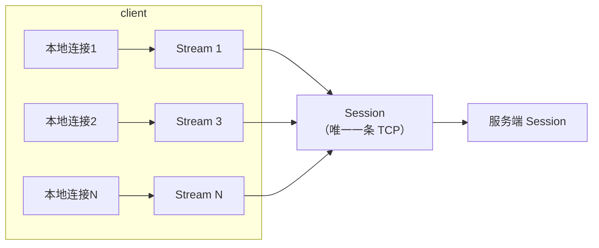

# 一条 TCP 上跑 100 条流：手写帧协议与 stream 生命周期

[上篇](./27.md)把端口转发拆成了握手、拨号、搬运、收尾四步，代码在本机跑通了。这篇把它搬到真实环境——然后立刻撞上两个问题，一个逼出 v2，一个留给 v3。

<!-- more -->

## 一、引子：跨机器跑一次才知道缺什么

上篇的代码在本机自测全绿，于是编译成 Mac 二进制拿到真机上跑：`Mac 客户端 → 开发机 9000 → 目标服务`。结果连上之后日志刷出一片 `tunnel server rejected, status=72`。

`72 = 0x48 = 'H'`，是 `HTTP/1.1 ...` 的首字节——链路上根本不是 minibridge。排查绕了一大圈才明白：**协议认不出对端不是自己人**，于是给握手加了 4 字节 magic `MBRD`（上篇已补）。

顺带暴露出更严重的事：服务端的 `:9000` 绑在所有网卡上，公网可直达，而 v1 既不鉴权也不限制目标地址——任何连上来的人都能让这台机器去连内网任意端口。临时解法是不改代码改用法：服务端只听 `127.0.0.1:9000`，Mac 走 `ssh -L` 把端口搬到本地。SSH 顺手补上了 v1 缺的加密和认证。

这两件事分别指向后面的两个阶段：认不出对端 → 协议健壮性；公网裸奔 → **v3 的 TLS 与白名单**。而 v2 要解决的，是另一个一眼可见的毛病。

## 二、v1 的代价：连接数和转发数 1:1

v1 里每来一条本地连接，就往服务端新开一条 TCP。100 条并发转发的账单是：

- 100 条 TCP：100 次三次握手、100 次慢启动、收尾后 100 个 `TIME_WAIT`
- 200 个 goroutine
- 100 份重复的握手报文

长连接场景（数据库连接池、WebSocket）下，**fd 会先于 CPU 打满**。而且这些连接干的活完全一样：都是把字节从 A 搬到 B。

v2 要做的就是把 100:1 变成 100 条流共享 1 条连接。

## 三、帧格式：先说清一帧有多长

```text
[ len:4 ][ type:1 ][ streamID:4 ][ payload:N ]
└──────── 9 字节固定头 ────────┘
```

两个字段的位置不是随便排的：

- **`len` 必须在最前面**。读帧时先 `ReadFull` 读满 9 字节头，再按 `len` 读 body——跟上篇握手、`Content-Length`、HTTP/2 帧头是同一个道理：不知道多长就读不对
- **`streamID` 必须在头里**。读循环每收到一帧就要立刻知道它属于哪条流，放 body 里就得先解析 body

七种帧撑起完整生命周期：

| type | 谁发 | payload | 含义 |
|---|---|---|---|
| `SYN` | 发起方 | 目标地址 | 请求开流 |
| `SYNACK` | 接受方 | 空 | 同意 |
| `RST` | 接受方 | 空 | 拒绝（目标不可达） |
| `DATA` | 双方 | 业务字节 | 数据 |
| `FIN` | 双方 | 空 | 半关闭 |
| `PING`/`PONG` | 双方 | 时间戳 | 保活（v5 启用） |

读帧的实现和上篇的 `readHandshake` 是同一个套路：

```go
func readFrame(r io.Reader) (frame, error) {
	head := make([]byte, frameHeaderLen)
	if _, err := io.ReadFull(r, head); err != nil {
		return frame{}, err
	}
	n := int(binary.BigEndian.Uint32(head[0:4]))
	if n > maxFramePayload { // 别信对端给的长度，先设上界
		return frame{}, fmt.Errorf("%w: %d bytes", errFrameTooLarge, n)
	}
	payload := make([]byte, n)
	if _, err := io.ReadFull(r, payload); err != nil {
		return frame{}, err
	}
	return frame{typ: frameType(head[4]), streamID: binary.BigEndian.Uint32(head[5:9]), payload: payload}, nil
}
```

## 四、三个对象：Session、Stream、读循环



- **Session**：持有一条 TCP、`map[uint32]*Stream`、一把写锁、一个读循环 goroutine
- **Stream**：会话上的一条流，**实现 `net.Conn`**
- **读循环**：读帧 → 按 `streamID` 找到 Stream → 投递或改状态

**让 Stream 实现 `net.Conn` 是整个 v2 最划算的设计决策**：上篇写的 `bridge(a, b)`、`io.Copy` 双向桥接，一行都不用改，直接把本地连接和 Stream 桥起来。抽象对了，上一层代码原样复用。

```go
var _ net.Conn = (*Stream)(nil) // 编译期确认：桥接代码可以无差别对待它
```

## 五、四个必须踩住的坑

### 1. streamID 为什么要分奇偶

客户端只用奇数（1,3,5…），服务端只用偶数（2,4,6…）。

原因是双方可能**同时**发起开流（v4 的反向转发就是这种场景）。如果两边都从 1 开始自增，就会同时开出 ID=1 的两条流——数据串在一起，而且极难复现。HTTP/2 用的就是这条规则，不是巧合。

### 2. 背压：投递时绝不能持锁

对端不读时不能无脑写，否则内存被帧队列吃光。最省事的做法是给接收队列设上限，**写满就阻塞**：

```go
func (st *Stream) deliver(p []byte) {
	select {
	case st.recv <- p:      // 队列满 → 阻塞
	case <-st.doneCh:       // 流已关闭 → 放弃
	}
}
```

阻塞会沿调用栈回传：投递卡住 → 读循环卡住 → TCP 接收窗口关闭 → 对端发送减速。整条链路自己就把速度降下来了。

**代价是这条投递路径上绝不能持锁**——读循环手里如果有 Session 的锁，一次阻塞就把整个会话上所有流一起卡死。所以代码里是先取到 Stream、释放锁、再投递。

### 3. 流的清理，以及会话断开的集体收尾

- 单条流结束（`FIN`）必须从 `map` 里 `delete`，否则长跑下 map 只增不减
- **会话断开时，必须把所有还活着的流一起关掉**，否则每条上层连接都会挂死——这是放大版的僵尸连接，v1 里只有一条，v2 里可能是几百条

### 4. 从"断言类型"改成"断言能力"

v1 的收尾代码是这样：

```go
if tcp, ok := dst.(*net.TCPConn); ok {
	_ = tcp.CloseWrite()
} else {
	_ = dst.Close()
}
```

到了 v2 就不好使了：`Stream` 明明能半关闭，但它不是 `*net.TCPConn`，会被降级成 `Close()`——半关闭语义整个丢失。

改成按**能力**断言：

```go
type halfCloser interface {
	CloseWrite() error
}

if hc, ok := dst.(halfCloser); ok {
	_ = hc.CloseWrite() // Stream 和 TCPConn 都走得通
} else {
	_ = dst.Close()
}
```

同一段桥接代码，从此既能服务 TCP 连接，也能服务 Stream。这条经验跟语言无关：**按能力断言比按具体类型断言活得久**。

## 六、实测

验收不靠"跑一下看看有没有回显"，而是钉住不变量：

| 用例 | 守住什么 |
|---|---|
| 100 条并发流跑单条连接 | 数据不串包 |
| 目标不可达 → `RST` | `Open` 立刻返回错误，且**不影响会话上其他流** |
| 半关闭穿透 | `CloseWrite` 后仍能收到目标补发的响应 |
| 会话断开 | 所有流一起收到 EOF，不留挂死连接 |

真实跑一次（客户端转发本机 8000 上的页面，5 个并发请求）：

```text
stream finished, id=1, target=127.0.0.1:8000, client_to_target=79, target_to_client=98008, err=<nil>
stream finished, id=3, ...
stream finished, id=5, ...
stream finished, id=7, ...
stream finished, id=9, ...
```

流 ID 是 `1,3,5,7,9`——客户端用的奇数号，5 条转发共用同一条会话。换成 v1，这里会是 5 条 TCP。

## 七、小结

一句话概括 v2：**多路复用没有魔法，就是给每个字节贴一个 streamID 标签，然后在一条连接上按标签分发**。

真正花时间的不是分发，而是那些"只有自己写才会撞上"的细节：ID 撞号、背压不能持锁、流的登记与注销、按能力而非类型收尾。上篇的握手、半关闭、快速失败这些决定，在 v2 里全部原样成立——好在设计是分层的，搬运层换掉，上面那层一点没动。

代码在 [example/2026/10/27](https://github.com/yiiewang/yiiewang.github.io/tree/master/example/2026/10/27)，`go test -count=1 -race ./...` 全绿。

下一步是 **v3：TLS + 证书校验 + 目标地址白名单**——也就是引子里那个"公网裸奔"的正解。到那时 minibridge 才敢自己监听公网端口。

---

*最后更新：2026-10-27*
