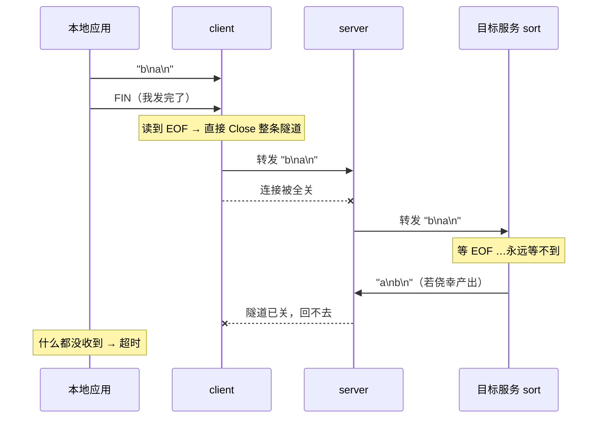
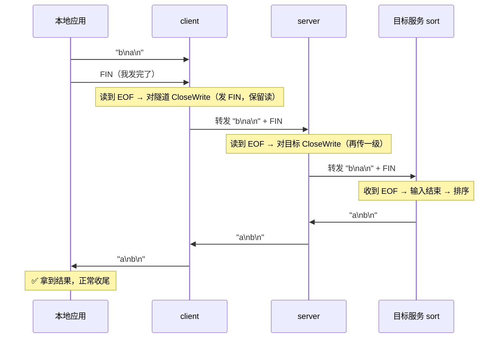

# 从 ssh -L 到自研多路复用：手写一个隧道协议

上次在服务器上 `ps -ef | grep ssh` 找不到 VSCode 的转发进程，搞明白它是"SSH 当加密网线、两端各挂一个桥接端点"之后，手就痒了——[《ps -ef | grep ssh 查不到的端口转发》](../09/02-1.md) 那篇只讲了原理，这次亲手写一个。

第一步不搞花活：**一条转发独占一条 TCP 连接**，先把字节搬对，再谈多路复用。

<!-- more -->

## 一、v1 要造什么

就一件事：让本机的 `18000` 端口等价于远端机器视角下的 `8000` 端口。


client 和 server 各是一个进程：`server` 跑在能访问目标服务的机器上，`client` 跑在你本机。一条本地连接进来，client 就往 server 新开一条 TCP，转发完就关——**连接数与转发数 1:1**，这是 v1 最笨的地方，也是它最好懂的地方。

## 二、握手：服务端得知道去哪

隧道连接建起来之后，server 面对的第一个问题是：你要我连谁？答案只能由 client 在连接建立时告诉它，这就是握手存在的唯一理由。

v1 的握手极简，请求四段、响应六字节：

| 字段 | 长度 | 说明 |
|---|---|---|
| magic | 4B | 固定 `MBRD`，用来一眼认出"对端不是自己人" |
| ver | 1B | 协议版本，v2 换帧协议时靠它区分 |
| len | 2B | 目标地址长度，大端 |
| target | N | 目标地址 `host:port`，从 **server 视角** 解析 |

响应是同一个套路：`[magic:4][ver:1][status:1]`，`status` 为 `0` 表示 dial 成功，`1` 表示目标不可达。

```go
func writeHandshake(w io.Writer, target string) error {
	if len(target) > maxTargetLen {
		return errTargetTooLong
	}
	buf := make([]byte, reqHeadLen+len(target))
	copy(buf[0:4], magic)
	buf[4] = protocolVersion
	binary.BigEndian.PutUint16(buf[5:reqHeadLen], uint16(len(target)))
	copy(buf[reqHeadLen:], target)
	_, err := w.Write(buf)
	return err
}
```

读的一侧有个所有自研协议都要过的坎：**一次 `conn.Read` 拿到多少字节都不保证**。几个字节的头部完全可能被拆成好几次到达。所以必须用 `io.ReadFull`，它会循环读满才返回：

```go
func readHandshake(r io.Reader) (string, error) {
	head := make([]byte, reqHeadLen)
	if _, err := io.ReadFull(r, head); err != nil { // 不是 r.Read
		return "", err
	}
	...
}
```

这条不变量值得单独写个测试——用一个每次只吐 1 字节的 reader 模拟拆包：

```go
type dripReader struct {
	data []byte
	off  int
}

func (d *dripReader) Read(p []byte) (int, error) {
	if d.off >= len(d.data) {
		return 0, io.EOF
	}
	n := copy(p, d.data[d.off:d.off+1]) // 每次只给 1 字节
	d.off += n
	return n, nil
}
```

`readHandshake(&dripReader{...})` 必须照样成功。写过一次就知道，HTTP 库把这件事盖得有多好。

### magic 是给"连错了"准备的

第一版没有 magic，客户端只读 1 字节状态。于是真实发生过一次：Mac 上的客户端连开发机的 9000 端口，日志刷出一片 `tunnel server rejected, status=72`。

`72 = 0x48 = 'H'`——那是 `HTTP/1.1 ...` 的首字节。链路上根本不是 minibridge，而是别的服务在回话，客户端却把人家响应的第一个字节当成状态位读了。日志里没有一个字提到 HTTP，只能靠推理。

加上 magic 之后，这类误连直接自报家门：

```go
func badPeerErr(prefix []byte) error {
	if len(prefix) >= 4 && string(prefix[:4]) == "HTTP" {
		return fmt.Errorf("peer is not a minibridge server (looks like HTTP, first bytes %q)", prefix[:4])
	}
	return fmt.Errorf("%w (first bytes %q)", errBadMagic, prefix)
}
```

顺带还有第二个收获：**读握手响应必须带 deadline**。对端不是自己人时，它可能永远凑不齐 6 个字节，`io.ReadFull` 就一直等着——没有超时，这个 goroutine 会永久挂住。握手阶段设 `SetReadDeadline`，进入转发阶段再清掉（转发本身不能有超时）。

这类坑的代价不在修复，在排查：加 magic 只是几行代码，但那次为定位 `status=72` 花了整整一轮抓包和推理。

## 三、桥接：io.Copy 与半关闭

握手之后就是纯粹的搬运。两个方向各起一个 goroutine 对拷，等都结束再关闭连接：

```go
func bridge(a, b net.Conn) (a2b, b2a int64, err error) {
	var (
		errA2B, errB2A error
		wg             sync.WaitGroup
	)
	wg.Add(2)
	go func() {
		defer wg.Done()
		a2b, errA2B = copyAndHalfClose(b, a)
	}()
	go func() {
		defer wg.Done()
		b2a, errB2A = copyAndHalfClose(a, b)
	}()
	wg.Wait()

	closeBoth(a, b)
	return a2b, b2a, firstErr(errA2B, errB2A)
}
```

**重点在 `copyAndHalfClose`**：某一方向读到 EOF 时，对另一端要调 `CloseWrite`（半关闭），而不是 `Close`。

```go
func copyAndHalfClose(dst, src net.Conn) (int64, error) {
	n, err := io.Copy(dst, src)

	if tcp, ok := dst.(*net.TCPConn); ok {
		_ = tcp.CloseWrite()
	} else {
		_ = dst.Close()
	}
	return n, err
}
```

### 半关闭到底是什么

一条 TCP 连接是 **两条独立的单向字节流**：我的写方向、我的读方向。`Close` 把两个方向一起关掉，`CloseWrite` 只关写方向（内核发出 FIN），读方向还开着。

| 调用 | 发出的信号 | 还能读对端的数据吗 |
|---|---|---|
| `Close()` | FIN；若接收缓冲区还有未读数据，内核直接发 RST | ❌ 不能 |
| `CloseWrite()` | FIN | ✅ 能 |

两者的话外音不同：`CloseWrite` 是 **"我发完了，你继续说"**，`Close` 是 **"我挂了"**。

### 场景：为什么非它不可

有一类服务必须收到 EOF 才知道"输入结束了"，然后才开始干活——`sort` 是最典型的：输入没读完就输出，排序结果是错的。类比 `wc -l`、批量导入，以及本文测试里那个"收完再回"的服务。

场景：本地把 `b\na\n` 经隧道发给远端的 `sort`，期望拿回 `a\nb\n`。

用 `Close`，链路会在半路被掐断：



用 `CloseWrite`，EOF 得以逐级传下去，反向通道也保住了：



**核心：EOF 是一个必须逐级往下传的信号。** 每一跳的动作都一样——读到 EOF，就对下一跳 `CloseWrite`。这也是上面那段代码在链路每个方向上都成立的原因。

### 为什么平时踩不到

多数 HTTP 请求不靠 EOF 判断请求结束，而是靠 `Content-Length` 或 chunked 终止块，客户端压根不会先发 FIN，双向几乎同时关闭，两种写法表现一致。

只有碰到"读到 EOF 才算输入结束"的语义时差别才暴露，而且是 **偶发** 的：多数请求恰好没有数据要补发，看起来没事；一旦有，响应就凭空消失，日志里还找不到任何错误——这类 bug 排查成本极高。

### 怎么验证

```bash
# 1. 隧道里的端到端用例
go test -run TestForwardPropagatesHalfClose -v ./v1-forward   # 绿
# 把 tunnel.go 里 tcp.CloseWrite() 改成 tcp.Close() 再跑 → 变红（读超时）

# 2. nc 演示"服务端在等 EOF"（与隧道无关，只看 FIN 这个信号）
nc -l 9000 | sort                              # 终端 1
printf 'b\na\n' | nc -N 127.0.0.1 9000         # 终端 2：终端 1 立刻输出 a / b ✅
printf 'b\na\n' | timeout 3 nc 127.0.0.1 9000  # 去掉 -N：卡 3 秒，终端 1 无输出 ❌
```

`nc -N` 就是命令行版的 `CloseWrite`：少了那个 FIN，对端的 `sort` 永远不会动。

## 四、跑通

两端各一条命令：

```bash
# 远端
go run ./v1-forward server -addr 127.0.0.1:19000

# 本机
go run ./v1-forward client -listen 127.0.0.1:18000 \
    -server 127.0.0.1:19000 -target 127.0.0.1:8000

curl http://127.0.0.1:18000/
```

真实跑通的日志（转发本机 8000 上一个 97KB 的页面）：

```text
http_code=200 size=97843
tunnel  finished, target=127.0.0.1:8000, client_to_target=79,    target_to_client=98008, err=<nil>
forward finished, target=127.0.0.1:8000, local_to_remote=79,     remote_to_local=98008,  err=<nil>
```

两个方向的字节数在链路上严格对称——请求 79 字节、响应 98008 字节，两端一致，`err=<nil>` 说明这条连接是正常终止而不是被 RST。

## 五、四个测试守住不变量

端到端转发最容易被写成"跑一下看看有没有回显"，那不算测试。真正要钉住的是这四条：

1. **回显往返**：写进去的字节能原样回来
2. **目标不可达**：服务端回 `statusDialFailed` 并关闭，本地必须读到 `EOF` 而不是永远挂着
3. **半关闭穿透**：客户端 `CloseWrite` 之后，仍能收到目标端补发的响应——把 `CloseWrite` 改成 `Close`，这条会立刻失败
4. **并发 20 条**：同时转发互不串包

第 2 条最容易被漏，而它恰恰是"僵尸连接"的来源：目标没了，本地连接还杵在那里等一个永远不来的响应。

## 六、v1 离 VSCode 还差三步

v1 能跑，但拿它跟 Remote-SSH 比，差距一目了然：

- **1:1 的连接模型**。100 条转发就是 100 条 TCP + 200 个 goroutine，长连接场景下 fd 先扛不住。解决办法是 v2：把"一条连接一条流"改成"一条连接多条流"，自己定义带 `streamID` 的帧——`[length:4][type:1][streamID:4][payload:N]`，`SYN / DATA / FIN / RST` 这几种类型就够撑起 stream 的生命周期。
- **没有加密和鉴权**。隧道裸奔，服务端的隧道端口谁都能连。
- **目标地址客户端说了算**。客户端让服务端连哪就连哪，这是个标准的 SSRF 面，生产环境必须配白名单。

前两条是 v2、v3 的事。v1 的价值在于：它把"端口转发"这件事拆成了握手、拨号、搬运、收尾四步，每一步都能单独看见、单独测。多路复用再复杂，也只是把"搬运"这一步从一对一变成一对多。

## 小结

一句话概括 v1：端口转发没有魔法，就是**握手告诉对端去哪 + 两个 `io.Copy` 对拷 + 结束时用半关闭收尾**。难度不在代码量，在那些只有自己写才会撞上的细节——拆包、半关闭、目标不可达时的干净收尾。

代码在 [example/2026/10/27](https://github.com/yiiewang/yiiewang.github.io/tree/master/example/2026/10/27)，`go test -count=1 -race ./...` 全绿。下一步是 v2：一条 TCP 上跑 100 条流，手写帧协议和 stream 生命周期。

---

*最后更新：2026-10-27*
