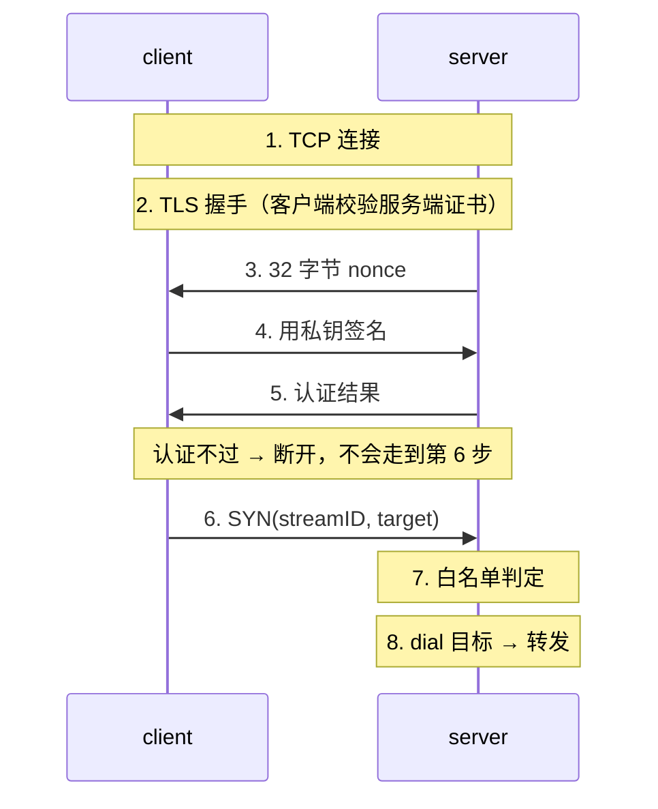

# 让隧道敢监听公网：TLS、认证与白名单的推导过程

[v2](./27-1.md) 之后，minibridge 能跑、能复用，但只敢绑在 `127.0.0.1`——真要监听公网，它身上有三个洞：**明文**、**谁都能连**、**目标地址随便填**。

这篇记录把这三个洞一层层堵上的过程。跟[上一篇](./28.md)一样，记录的是**推导**而不是成品：每一步都是被一个具体问题逼出来的。

<!-- more -->

## 零、起点：三个洞，和一个临时解法

| 洞 | 后果 |
|---|---|
| 明文 | 抓包就能看到全部内容 |
| 无鉴权 | 谁连上都能用 |
| 目标随便填 | 任何人都能让这台机器去连内网任意端口（SSRF） |

此前一直在用的临时解法是：服务端只听回环，Mac 走 `ssh -L`。这个解法本身没问题——它把加密和认证**外包给了 SSH**，minibridge 一行代码都不用改。

但它治的是"不敢暴露"，不是"能暴露"。想让 minibridge 自己站得住，这三件事得自己扛。

## 一、第 1 步：换成 TLS

改动很小：`net.Listen` → `tls.Listen`，`net.Dial` → `tls.Dial`。

**立刻撞墙**：证书从哪来？

## 二、第 2 步：证书从哪来

生产环境的答案是企业 CA 或 Let's Encrypt（ACME）；为了让示例可复现，这里用**自签 CA + 服务端证书**（`certs.go` 里几十行）。

自签和正规 CA 的差别只在"**谁来证明这张证书可信**"，协议本身完全一样。

踩到一个小坑：`ExtKeyUsage` 必须跟用途对上——服务端证书要 `ServerAuth`，客户端证书要 `ClientAuth`。少写这一项，握手会以 `certificate specifies an incompatible key usage` 失败。

## 三、第 3 步：最容易写错的一行

```go
&tls.Config{InsecureSkipVerify: true}   // 加了等于没加
```

这是 TLS 的头号坑。它让连接**加密但不认证**——中间人随手插一根，就能在两端各建一条 TLS、把流量看得一清二楚，而代码看起来是"跑通的"。

正确写法必须指定两样东西：

```go
&tls.Config{
	RootCAs:    caPool,    // 信谁签的证书
	ServerName: "127.0.0.1", // 校验证书里的名字
	MinVersion: tls.VersionTLS13,
}
```

少任何一样，TLS 都只剩"看起来是绿的"这一层。所以测试里钉了一条：**用另一家 CA 签的服务端证书，客户端必须连不上**。

## 四、第 4 步：顺序——先认证，后转发

这一步是安全上最要紧的，也是最容易被"先跑通再说"跳过的。

**撞墙**：如果 TLS 握手一完就 `newSession()` 开始收 `SYN`，那么在认证还没通过的那段时间里，对方已经能让你去 dial 目标了——**等于给陌生人留了一个 SSRF 入口**，而且是在加密通道里留的。

改法是把认证放在会话创建之前：

```go
if err := auth.Server(conn); err != nil {
	conn.Close()   // 认证没过，会话根本不创建
	return
}
serveSession(newSession(conn, false), allow)
```

完整的顺序：



## 五、第 5 步：白名单，治 SSRF

**撞墙**：目标地址是客户端在 `SYN` 里带过来的，说连哪就连哪。

规则设计上有两个刻意的限制：

1. **只收 IP 和 CIDR，拒绝域名**。域名会在"校验"和"真正拨号"之间留下二次解析的缝——也就是 DNS rebinding：校验时解析到内网地址、放行，拨号时解析到另一个地址
2. **`Resolve` 命中后返回 IP 形式**的地址（`127.0.0.1:8000` 而不是 `localhost:8000`），直接拿去拨，不再解析第二次

判定点在 `dial` **之前**：不允许的目标，一个包都不往外发，直接回 `RST`。

## 六、第 6 步：认证做成可插拔

```go
type Authenticator interface {
	Name() string
	Server(conn net.Conn) error  // 服务端验证客户端
	Client(conn net.Conn) error  // 客户端证明身份
}
```

两个实现：

| 实现 | 做法 |
|---|---|
| `sshKeyAuth`（默认） | 服务端发 32 字节 nonce；客户端用私钥签名；服务端拿 `authorized_keys` 验签 |
| `x509Auth` | **空实现**——mTLS 的校验 `crypto/tls` 在握手内就做完了，应用层无事可做 |

这里有个容易混淆的点值得说清：**`sshKeyAuth` 用的不是 SSH 协议，只是 SSH 的密钥格式和签名算法**。SSH 协议把"通道加密"和"身份认证"打包在一起了，我们只是把认证那一层拆出来——挑战-响应这件事本身跟通道用什么加密无关，裸 TCP、TLS 上都能跑。

两种实现的**插入点不同**：

- `mTLS` 的校验发生在 **TLS 握手内**（库帮你做）
- `sshKeyAuth` 必须在 **TLS 握手之后的应用层**自己做

原因是 `crypto/tls` 只认 X.509——你把 SSH 公钥塞进 `tls.Config` 它不认。所以这个组合是"TLS 通道 + SSH 密钥认证"的混搭，不是标准搭配，但能用已有密钥、省掉给每个客户端发证书的麻烦。

## 七、一个实测撞到的坑：TLS 1.3 的裁决延迟

写完 mTLS 测试时发现：**客户端不带证书，`tls.Dial` 竟然成功了**。

```go
conn, err := tls.Dial("tcp", addr, cfg)  // err == nil？！
```

原因在 TLS 1.3 的握手时序：**客户端在收到服务端对证书的裁决之前，就认为自己的握手完成了**。服务端随后发现没有客户端证书，直接关掉连接——但这个结果要等到**第一次读写**才暴露给客户端。

后果很实在：如果代码只在 `Dial` 成功后就认为"认证通过"，**mTLS 等于白配**。所以：

```go
conn.SetReadDeadline(time.Now().Add(2 * time.Second))
if _, err := conn.Read(make([]byte, 1)); err == nil {
	t.Fatal("server must reject client without certificate")
}
```

判断认证是否真的通过，要以**第一次读写**为准，不是以握手函数返回为准。

## 八、验收清单

| 用例 | 守住什么 |
|---|---|
| 陌生 CA 签的服务端证书 | 客户端连不上（证书校验真的在工作） |
| 明文客户端 | 建不了会话 |
| `mTLS` 不带客户端证书 | 首次读写失败（不是 `Dial` 失败） |
| `sshkey` 用错钥匙 | 认证失败、连接断开 |
| 白名单外的目标 | 直接 `RST`，一个包都不往外发 |
| 正常路径 | TLS + 认证 + 转发全部走通 |

## 九、小结

v3 加的三层其实各管一件事，别混：

| 层 | 管什么 | 搞错了会怎样 |
|---|---|---|
| **TLS** | 加密 + **服务端**身份 | `InsecureSkipVerify` 一开，等于只剩加密 |
| **认证** | **客户端**身份 | 放在建会话之后，等于给陌生人留 SSRF |
| **白名单** | 能拨号到哪 | 用域名做规则，等于给 DNS rebinding 开门 |

一句话：**加密解决"别人看不见"，认证解决"别人用不了"，白名单解决"别人指使不动"**。三件事缺一件，所谓的"安全隧道"就只是看起来安全。

代码在 [example/2026/10/27/v3-crypto](https://github.com/yiiewang/yiiewang.github.io/tree/master/example/2026/10/27/v3-crypto)，`go test -count=1 -race ./...` 全绿。

下一步是 **v4：反向转发与控制面**。有意思的是，v2 已经把 `Open`/`Accept` 做成对称的了——服务端主动开流这条路其实已经铺好，v4 要加的只是配置和控制面。

---

*最后更新：2026-10-28*
