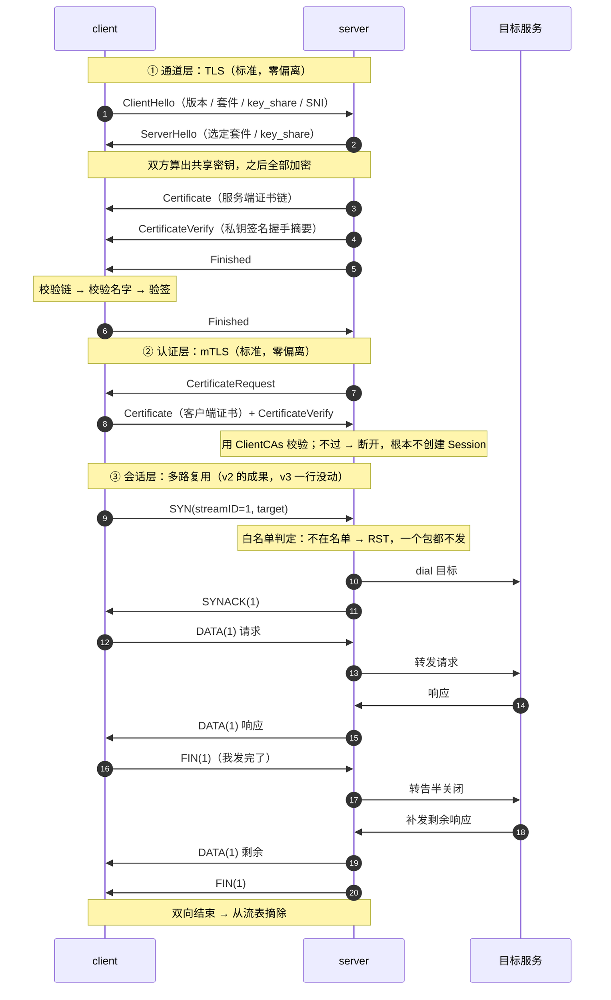

# 让隧道敢监听公网：三个问题、标准方案与我们的取舍

[v2](./27-1.md) 之后，minibridge 能跑、能复用，100 条转发压在一条 TCP 上。但它有个尴尬：**只敢绑在 `127.0.0.1`**。

这篇讲清楚四件事：它到底有什么问题、业界的标准方案是什么、我们怎么落的、以及我们在哪几处**刻意偏离了标准**、代价是什么。不需要 TLS 基础。

<!-- more -->

## 一、背景：一条只敢绑在回环上的隧道

v2 的服务端实际是这么跑的：

```bash
go run ./v2-mux server -addr 127.0.0.1:9000   # 只听回环
```

然后从 Mac 访问要走一层 ssh：

```bash
ssh -L 9000:127.0.0.1:9000 root@server        # 把端口搬到本地
```

这套办法**本身没问题**——它把加密和认证外包给了 SSH，minibridge 一行代码都不用改。但它治的是"不敢暴露"，不是"能暴露"：**只要你想让 minibridge 直接监听公网，就得自己扛下所有的事**。

所以目标很具体：**让 minibridge 敢自己监听公网端口**。

## 二、三个问题，以及不管会怎样

| # | 问题 | 具体后果 |
|---|---|---|
| 1 | **明文** | 链路上任何一跳都能看到全部内容——转发的可是内网服务的流量 |
| 2 | **无鉴权** | 谁连上都能用。等于在互联网上挂了一个**开放代理** |
| 3 | **目标地址任意** | 客户端在开流时说连哪就连哪。任何人都能让这台机器去连内网任意端口——这是标准的 **SSRF**，云厂商元数据服务 `169.254.169.254` 是经典目标 |

这三个不是理论风险。第 1 条抓一次包就现形；第 2、3 条合起来意味着：一个扫描器发现 `9000` 端口后，可以拿这台机器当跳板探测整个内网，而且**没有任何日志**。

补一句相关的：此前还踩过一次"**协议认不出对端不是自己人**"（连到 HTTP 服务时日志打出莫名其妙的 `status=72`）。那次修的是协议健壮性，这次要修的是安全。

## 三、标准方案是什么

先说业界怎么做，再看我们改了什么——不对照标准，就看不出取舍。

### 加密 + 服务端身份：TLS

```text
ClientHello / ServerHello → 协商出共享密钥（之后全部加密）
服务端 → Certificate（证书链）+ CertificateVerify（私钥签名握手摘要）
客户端 → 校验证书链、校验名字、验签
```

关键点：**加密和认证是绑死的**。`CertificateVerify` 签的是整段握手内容的摘要，中间人原样转发证书也签不出这个签名——所以换不掉、重放不了。

两个必须知道的常识：

- **标准 TLS 只认证服务端**。HTTPS 网站 99% 都是这样，客户端是谁交给应用层的 Cookie / token 解决
- 从 SSH 转过来的人容易搞混：**SSH 登录是双向的**（host key + 客户端公钥），**TLS 默认单向**

### 双向认证：mTLS

要做"连接建立时双方互证"，**标准方案只有 mTLS**：在标准握手之后多一轮——服务端发 `CertificateRequest`，客户端回自己的证书 + `CertificateVerify`，服务端用 `ClientCAs` 校验。

在 Go 里落地就是两行：

```go
cfg.ClientCAs = caPool
cfg.ClientAuth = tls.RequireAndVerifyClientCert
```

它的真成本在证书生命周期：签发（每个客户端一张）、轮换、**吊销**（CRL / OCSP——标准库握手时并不查，得自己做）。这也是现实里很多人改用"单向 TLS + 应用层 token"，或让服务网格（Istio / Linkerd）用 sidecar 统一托管 mTLS 的原因。

### 授权（能访问哪）

**这不是 TLS 的事**。TLS 只回答"你是谁"，"你能干什么"必须由应用层自己实现——对我们的场景就是**目标白名单**。

### 问题 → 标准方案对照

| 问题 | 标准方案 | 规范 |
|---|---|---|
| 明文 + 服务端身份 | TLS | RFC 8446 |
| 客户端身份（双向） | mTLS | RFC 8446；OAuth 场景 RFC 8705 |
| 能访问哪 | 应用层自己实现（白名单） | 无标准，自己定 |

## 四、我们怎么落的

完整流程如下。认证没有做成应用层可插拔的一环，而是**直接吃 TLS 的标准能力**——这样"认证不过"和"握手失败"是同一件事，中间留不出任何窗口。



顺序是这套设计的要害，三步都不能换：

1. **先 TLS（内含 mTLS 客户端校验）**：不加密就没有任何后续可言。客户端证书不对的连接在握手阶段就被丢掉，压根到不了应用层——所以"认证"和"建会话"之间不可能存在中间态，对方也就不可能在认证通过前发 `SYN` 让你 dial 目标
2. **白名单在 dial 之前**：不允许的目标，一个包都不往外发

### 哪个环节可替换，哪个不能

| 环节 | 能否替换 | 说明 |
|---|---|---|
| TLS 通道 + 双向证书校验 | ❌ 固定 | 换掉就等于没有加密和身份认证 |
| 白名单策略 | ⚙️ 可配不可换 | 规则来自 `-allow`，判定时机固定（dial 之前） |
| 会话 / 多路复用 / 转发 | ❌ 固定 | v2 的成果，v3 完全没动 |

认证没被抽成接口，是因为**不需要**：它整个由 `crypto/tls` 承担，`ClientCAs` +
`ClientAuth` 两行配置就是全部实现。少一层抽象，也少一处"配置漏了但代码还在跑"的风险——
`x509Auth` 那个空实现就踩过这个坑：忘了设 `ClientAuth`，认证形同虚设，而代码一切如常。

## 五、我们偏离了什么（以及哪里没偏离）

这一版**没有偏离**。认证走 mTLS，是 RFC 8446 里的标准流程，校验发生在握手内，由 `crypto/tls` 完成。

| 项 | 标准做法 | 我们 | 性质 |
|---|---|---|---|
| TLS 通道 + 服务端校验 | TLS + `RootCAs` + `ServerName` | 同样 | 零偏离 |
| 客户端认证 | 客户端证书，握手内校验 | 同样：`ClientCAs` + `RequireAndVerifyClientCert` | **零偏离** |
| 白名单规则 | 常见实现允许域名 | 只收 IP / CIDR | 加严 |
| 认证与建会话的顺序 | 标准未规定 | 认证不过就不创建 Session | 加严 |

（证书来源那条不算设计偏离：示例用自签 CA 只为可复现，生产的正确做法就是企业 CA 或 Let's Encrypt。）

### 曾经偏离过，后来砍了

第一版做过一条 `sshkey` 路线：TLS 握完，服务端发 32 字节 nonce，客户端用 OpenSSH 私钥签名，
服务端拿 `authorized_keys` 验签。**它用的不是 SSH 协议，只是 SSH 的密钥格式与签名算法**——
挑战-响应这件事本身跟通道用什么加密无关，nonce 也是在已加密的通道里传的。

动机很实际：复用现成的 `~/.ssh/id_ed25519`，省掉给每个客户端签证书。但账算下来不成立：

| 理由 | 说明 |
|---|---|
| 省错了地方 | 服务端证书两种路线都得生成，那是 TLS 层的常量。真正省下的只有客户端侧那份证书 |
| 非标准 | 第三方系统大概率只认 mTLS |
| 无吊销体系 | 只能从 `authorized_keys` 删一行，重连才生效 |
| **空实现陷阱** | `Authenticator` 接口配一个 `x509Auth` 空实现，"服务端到底有没有校验客户端"就取决于 `tls.Config` 有没有配对——漏一行配置认证就没了，代码照样编译、照样跑 |

最后一条是决定性的。与其留一个"配错了就裸奔"的开关，不如让认证**只能**由 TLS 来做：
校验失败的连接根本进不到应用层，不存在"认证没过但已经能驱动服务端 dial"的窗口。

所以现在的认证没有接口，只有两行配置：

```go
cfg.ClientCAs  = loadCertPool(clientCA)
cfg.ClientAuth = tls.RequireAndVerifyClientCert
```

## 六、踩到的两个坑

**1）`InsecureSkipVerify` 等于没加密**

```go
&tls.Config{InsecureSkipVerify: true}   // 加密但不认证
```

中间人随手插一根，两端各建一条 TLS，流量看得一清二楚，而代码看起来是跑通的。正确写法必须带上 `RootCAs` + `ServerName`。测试里钉了一条：**用另一家 CA 签的证书，客户端必须连不上**。

**2）TLS 1.3 的裁决延迟**

mTLS 测试时发现：客户端不带证书，`tls.Dial` 竟然成功了。

```go
conn, err := tls.Dial("tcp", addr, cfg)  // err == nil？！
```

原因是 TLS 1.3 的时序：**客户端在收到服务端对证书的裁决之前，就认为自己的握手完成了**。裁决要等第一次读写才暴露。

后果很实在：如果代码只在 `Dial` 成功后就认为"认证通过"，**mTLS 等于白配**。

对策是主动把裁决逼出来——发一帧 `PING`，等 `PONG`：

```go
func (s *Session) Handshake(timeout time.Duration) error {
	if err := s.writeFrame(frame{typ: framePING}); err != nil {
		return err
	}
	select {
	case <-s.pongCh:
		return nil                 // 服务端收了我
	case <-s.doneCh:
		return ErrSessionClosed    // 服务端拒收，连接已经关了
	case <-time.After(timeout):
		return errors.New("minibridge: handshake timeout, peer did not answer PING")
	}
}
```

服务端拒收时会直接关连接，于是等到的就是 `doneCh` 而不是 `PONG`。客户端在建会话之后、
监听本地端口之前调它，拿不到 PONG 就退出并报"检查 `-cert`/`-key` 与服务端的 `-client-ca`"。

这一步的价值不在多一次往返，而在**错误出现的位置**：根因在第一条流之前就暴露，
而不是等转发失败后，让人从一堆 `open stream failed` 里猜。

顺带一个意外收获：`PING`/`PONG` 原本标注"v5 启用"，握手先用上了，保活那条路提前被验证过一次。

## 七、验收清单

| 用例 | 守住什么 |
|---|---|
| 陌生 CA 签的服务端证书 | 客户端连不上（证书校验真的在工作） |
| 明文客户端 | 建不了会话 |
| 不带客户端证书 | `Handshake` 拿不到 PONG，客户端直接退出（不是 `Dial` 失败） |
| 带 `-client-ca` 签发的客户端证书 | 完整走通一次转发 |
| 白名单外的目标 | 直接 `RST`，一个包都不往外发 |
| 正常路径 | TLS + 转发全部走通 |

## 八、小结

三件事各管各的，别混：

| 层 | 管什么 | 搞错了会怎样 |
|---|---|---|
| **TLS** | 加密 + **服务端**身份 | `InsecureSkipVerify` 一开，只剩加密 |
| **认证** | **客户端**身份 | 放在建会话之后，等于给陌生人留 SSRF |
| **白名单** | 能拨号到哪 | 用域名做规则，等于给 DNS rebinding 开门 |

方法论上只有一句：**先把标准方案搞清楚（TLS / mTLS / 证书体系），再决定偏离哪里**。偏离不可怕，可怕的是不知道自己偏离了什么、代价是什么。这一版绕了一圈后的结论是：认证这块**不值得偏离**——mTLS 已经把事做对了，自己发明一套换来的只有风险和一个"配错就裸奔"的开关。

代码在 [example/2026/10/27/v3-crypto](https://github.com/yiiewang/yiiewang.github.io/tree/master/example/2026/10/27/v3-crypto)，`go test -count=1 -race ./...` 全绿。

下一步是 **v4：反向转发与控制面**。有意思的是，v2 已经把 `Open`/`Accept` 做成对称的——服务端主动开流这条路其实已经铺好了。

---

*最后更新：2026-10-28*
