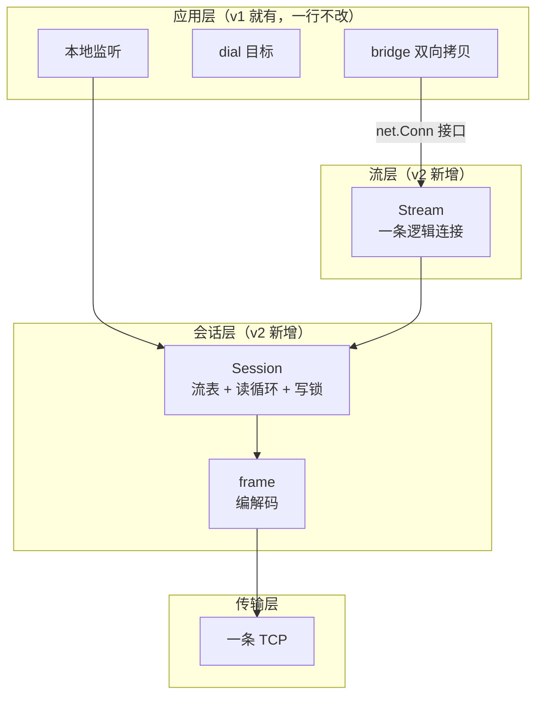
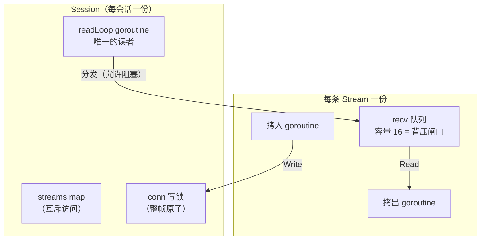
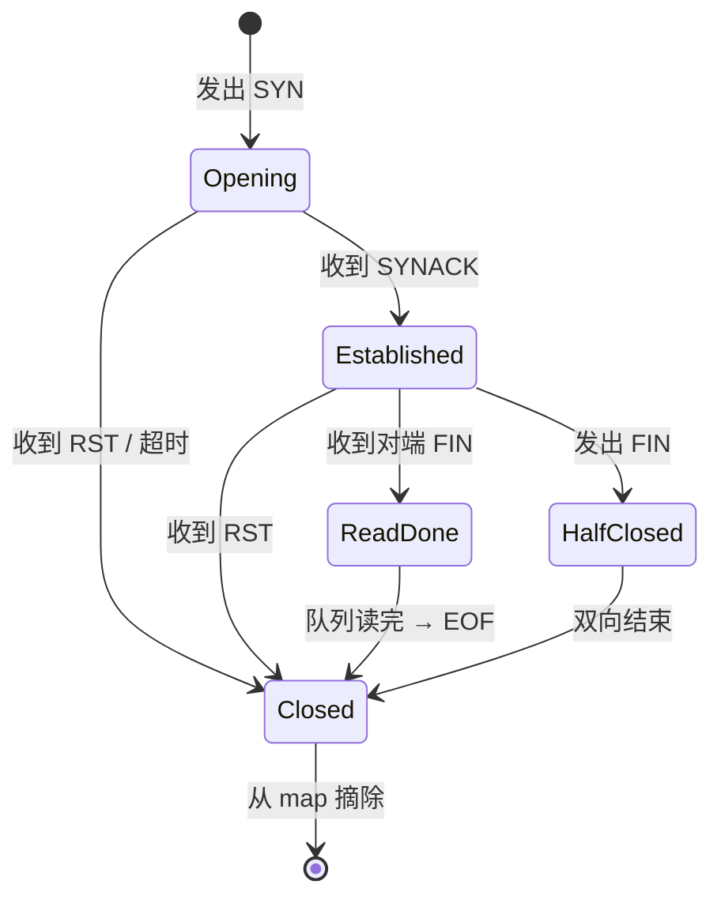

# 设计多路复用系统的六张图

写完 [minibridge v2](./27-1.md) 之后回头看，最难的不是代码，是**怎么把"一条 TCP 上跑 N 条流"这件事想清楚**。

软件工程的答案不是"灵感"，而是**多视图建模**：一个系统从几个固定角度各画一张图，每张图只回答一类问题。代码是这些图的翻译。这套方法的标准框架有两个——Kruchten 的 **4+1 视图**（1995）和 Simon Brown 的 **C4 模型**。

<!-- more -->

下面就是 minibridge v2 在设计时该有的六张图。顺序不能换：前一张是后一张的输入。

## 视图一：场景视图（谁用、干什么）

回答：**系统为谁服务，有哪些必须处理的场景**。这是所有设计的输入，也是最后验收的依据。


场景清单——每一条后面都会变成一个测试用例：

| 场景 | 必须保证 |
|---|---|
| 正常转发 | 字节原样往返 |
| 目标不可达 | 立刻失败，不挂死 |
| 半关闭 | 我发完了仍能收响应 |
| 会话断开 | 所有流一起收尾 |
| 对端连错 | 立刻认出不是自己人 |

## 视图二：逻辑视图（由哪些部件组成）

回答：**职责怎么切分、边界在哪、层与层靠什么接口对话**。



这一层的关键决策：**应用层只依赖 `net.Conn` 接口，不认识 `Stream`**。所以流层是可替换的——换成别的多路复用实现，应用层零改动。

这条边界决定了后面所有复杂度都被关在会话层内部，不外溢。

## 视图三：进程视图（运行时谁在跑、共享什么）

回答：**有几个执行体、谁拥有哪些资源、它们怎么通信**。并发系统的成败全在这一张图。



三条从这张图直接读出来的铁律：

1. **只有一个读者**——两个 goroutine 同时读一条 TCP 会把帧读乱
2. **写必须串行**——整帧一次写完，否则字节交错成半帧
3. **投递允许阻塞、但绝不能持锁**——阻塞是为了背压，持锁会连坐整条会话

这三条不是经验谈，是这张图的**直接推论**：箭头标了"允许阻塞"的那条路径，就不能同时持有标了"锁"的资源。

## 视图四：行为视图（关键场景怎么交互）

回答：**对象之间按什么顺序协作**。这是时序图的职责。

```mermaid
sequenceDiagram
    participant L as 本地连接
    participant C as client
    participant S as server
    participant T as 目标

    L->>C: 新连接
    C->>S: SYN(id, target)
    alt dial 成功
        S->>C: SYNACK(id)
        C<->>S: DATA(id) 双向
        L->>C: FIN（我发完了）
        C->>S: FIN(id)
        S->>C: DATA(id) 剩余响应
        S->>C: FIN(id)
        Note over C,S: 双向结束 → 从 map 摘除
    else dial 失败
        S->>C: RST(id)
        Note over L: 立刻关闭，不挂死
    end
```

注意 `FIN` 之后还有一段 `DATA`：这正是半关闭的意义——我发完了，但你补发的响应我还要收。

## 视图五：状态视图（一个实体的生命周期）

回答：**有哪些状态、什么事件触发迁移**。协议类系统的核心视图。



这张图的作用：把"什么情况下可读、什么情况下可写"变成**可查的表**，而不是散落在代码里的 `if`。协议 bug 九成出在状态迁移没覆盖全。

## 视图六：决策记录（ADR）

回答：**关键岔路口选了哪条路、放弃了什么**。软件工程要求这些显式留档，否则半年后没人记得为什么这么写。

| 决策 | 备选 | 选择 | 理由 |
|---|---|---|---|
| 复用粒度 | 每请求一条 TCP / 连接池 / 多路复用 | 多路复用 | 目标是把连接数从 O(转发) 降到 O(1) |
| 流标识 | 两端各自递增（会撞号） | 奇偶分配 | 支持双向开流，HTTP/2 同规则 |
| 背压 | 无限队列 / 窗口通告 | 固定队列 + 阻塞 | 最简且正确；窗口通告留到 v5 |
| 流的抽象 | 自定义类型 | 实现 `net.Conn` | 上层代码零改动 |
| 收尾断言 | `*net.TCPConn` | `halfCloser` 接口 | 按能力而非按类型，兼容 Stream |

## 每个视图对应什么验证

设计不是画完就完事，每张图都要能被证伪：

| 视图 | 坏掉的现象 | 验证手段 |
|---|---|---|
| 场景 | 功能不对 | 端到端回显测试 |
| 逻辑 | 改一处动全身 | 编译期断言 `var _ net.Conn` |
| 进程 | 数据竞争、死锁 | `go test -race` |
| 行为 | 时序错乱 | 一条流 RST 不影响其他流 |
| 状态 | 连接泄漏、挂死 | 会话断开后所有流都收到 EOF |

## 小结

一句话：**软件工程不设计"代码"，它设计"一组视图"**——场景定需求、逻辑定边界、进程定并发、行为定交互、状态定生命周期、决策记录留取舍。

六张图过完，代码只是把它们翻译出来。反过来，如果某张图画不出来，说明那部分还没想清楚，这时候动手写代码，只会写出一堆要推倒重来的东西。

代码在 [example/2026/10/27](https://github.com/yiiewang/yiiewang.github.io/tree/master/example/2026/10/27)，`mux.go` 顶部那三条不变量，就是视图三里那三个箭头的文字版。

---

*最后更新：2026-10-28*
