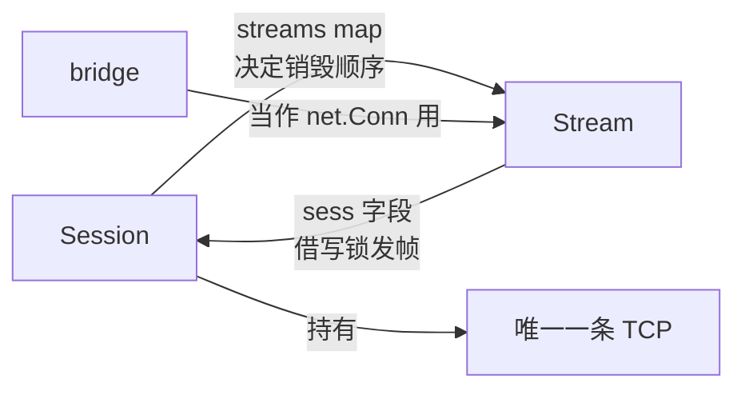
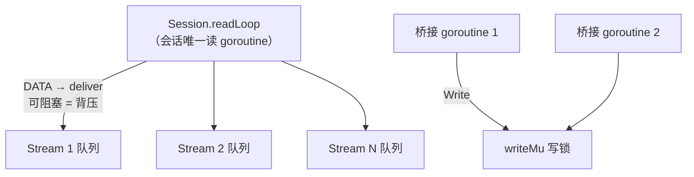

# 看得懂却写不出：并发结构的设计从哪下手

[minibridge v1](./27.md) 的端口转发我能自己写，[v2 的多路复用](./27-1.md)读一遍就懂——但让我从空白文件开始写 `Session` 和 `Stream`，第一笔不知道画在哪。

不是看不懂：`Session` 持有 `conn`、`Stream` 反向引用 `Session`、读循环把帧分发给流、流又借会话的锁写帧，这些交叉调用我都能理解。卡住的是**做不出结构决策**。

<!-- more -->

这种"能判断、能 review，但做不出从零的结构决策"的状态，比完全不懂更难受——因为你明明知道该往哪走，就是迈不出第一步。这篇把它拆开看：缺的是什么、有什么方法论能补、以及一份能照着做的流程。

## 一、先看清楚缺的是什么

不是语法，不是 API 不熟，是三种心智模型没内化。

**① 所有权与生命周期**

谁创建谁、谁持有谁、谁销毁谁、销毁时通知谁。

`Session` 和 `Stream` 相互引用，看着绕，其实两个方向的箭头回答的是两个不同问题：

- `Session → Stream`（`map[streamID]*Stream`）：**销毁顺序**。会话没了，所有流必须一起收尾
- `Stream → Session`（`sess` 字段）：**能力调用**。流要发帧，得借会话的写锁

**② 事件思维取代调用思维**

v1 是调用思维：我 dial、我写、我读、我关，一条直线走到底。
v2 是事件思维：读循环是**事件源**，帧来了分发，谁在等谁就被动响应——`Open` 在等 `SYNACK`，`Read` 在等 `DATA`。

这就是"读得懂写不出"的核心原因：**代码里看不到主线了**，它变成一张状态转移表。

**③ 并发约束的边界感**

几个 goroutine、谁能阻塞谁、锁保护什么。比如 `deliver` 投递数据时绝不能持锁——因为它会阻塞（背压），持锁阻塞会把整条会话上所有流一起卡死。

这种判断没人能教你，只能靠被死锁打脸几次积累。

## 二、为什么"读得懂写不出"

一句话：**读代码时看到的是决策的结果，写代码时要做的是决策本身。**

读一百遍训练的是识别力，不是决策力。就像看别人下棋和自己落子是两回事——你能看出每一步的意图，不代表轮到你时知道该往哪落。

## 三、能真正帮上忙的方法论

先泼盆冷水：Fred Brooks 在 1986 年《No Silver Bullet》里就讲清楚了，**没有方法论能保证"完美方案"**。方法论的价值是把设计从"灵感"变成"可显式、可 review 的决策"——做完能说清自己取舍了什么，别人也能对着清单挑毛病。

在这个场景里真正管用的九条：

| 方法论 | 出处 | 对应到 minibridge |
|---|---|---|
| **契约式设计**（不变量是设计产物） | Bertrand Meyer，《Object-Oriented Software Construction》 | `mux.go` 顶部三条不变量 |
| **结构化并发**（goroutine 必须有归属） | Martin Sústrik 2016；Nathaniel Smith 2018 | 一个会话只有一个读 goroutine；会话关闭时所有流一起收尾 |
| **CSP / 消息传递** | C.A.R. Hoare 1978 | `Stream.recv` 用 channel，背压天然由阻塞表达 |
| **Actor 思路**（一个 goroutine 独占状态） | Hewitt 1973 | `streams` 只由读循环和持锁路径修改 |
| **Reactor 模式**（单事件源 + 分发） | Schmidt, POSA2 | `readLoop` 就是 reactor |
| **状态机建模** | 协议工程常规做法 | 流的 5 个状态，代码只是状态转移的翻译 |
| **信息隐藏 / 按能力抽象** | Parnas 1972 | `Stream` 实现 `net.Conn`；`bridge` 断言 `halfCloser` 接口 |
| **Postel 定律**（发送保守、接收宽容） | RFC 793, Jon Postel | 找不到流的帧静默丢弃，不打断会话 |
| **Gall 定律**（复杂系统从简单系统演化而来） | John Gall,《Systemantics》1975 | v1 → v2 的路径 |

挑四条最关键的展开：

**契约式设计**——不变量不是写完代码后补的注释，是**设计的产物**。我那三条（整帧原子写、投递不持锁、结束必摘除）是在写第一行代码前就定的，后面每个函数都对着它检查。这三条决定了锁加在哪、能不能阻塞、谁负责摘除。

**结构化并发**——"不要有野生的 goroutine"。每个 goroutine 必须有明确的归属和退出路径：读循环属于会话，会话关闭它就退出；桥接的两个 goroutine 属于流，流结束它们就退出。做不到这点，长跑一定会泄漏。

**Reactor**——一旦确认"只有一个读 goroutine"，很多问题就消失了：不需要多读锁、分发顺序天然确定、背压只要卡住这一个 goroutine 就能传导到 TCP 窗口。这是把复杂度从"N 个并发读者"降到"1 个事件循环"的关键一刀。

**Gall 定律**——"能用的复杂系统一定是从能用的简单系统演化来的"。v1 是 1:1 的傻版本，但它**能跑**；v2 只是在它的搬运层上加约束。反过来，凭空设计 v2 我做不到，你也不用指望自己做得到。

## 四、可执行的四步

我写这份代码时脑子里过的是这四张图，**顺序不能换**：

**第 1 步：对象引用图**



箭头方向决定两件事：销毁顺序（顺箭头销毁）、锁的层级（避免反向持锁）。

**第 2 步：goroutine 归属图**



谁能阻塞谁一目了然：只有 `readLoop` 允许阻塞（它会反压到 TCP），持有 `writeMu` 的路径**绝对不能**阻塞。

**第 3 步：状态机**

| 状态 | 进入事件 | 可读 | 可写 |
|---|---|---|---|
| 打开中 | 发出 `SYN` | ❌ | ❌ |
| 已建立 | 收到 `SYNACK` | ✅ | ✅ |
| 半关闭（我发完） | 发出 `FIN` | ✅ | ❌ |
| 读侧结束 | 收到 `FIN`/`RST` | 读完剩余后 EOF | 视对端而定 |
| 已结束 | `Close` | ❌ | ❌ |

**第 4 步：不变量清单**（就是那三条）

**第 5 步才写代码，而且先写骨架**——类型、字段、函数签名、职责注释，实现全留空：

```go
// 第一步只写骨架：决策都在这儿，填实现是机械劳动
type Session struct {
	conn     net.Conn
	writeMu  sync.Mutex
	streams  map[uint32]*Stream
	acceptCh chan *Stream
}

func (s *Session) Open(target string) (*Stream, error) // 我主动开：发 SYN，等 SYNACK/RST
func (s *Session) Accept() (*Stream, error)            // 等对端开：从 acceptCh 取
func (s *Session) readLoop()                           // 唯一事件源：读帧 → 分发
func (s *Session) writeFrame(f frame) error            // 整帧原子写

type Stream struct { /* 实现 net.Conn */ }
func (st *Stream) Read(p []byte) (int, error)
func (st *Stream) Write(p []byte) (int, error)
func (st *Stream) CloseWrite() error // 半关闭：发 FIN
```

**骨架就是决策本身。** 画不出骨架，说明决策没做完，这时候硬写实现只会写出一堆要推倒重来的代码。

## 五、没有银弹

清单能保证"不漏掉关键点"，**不能保证"切分最优"**。

最优靠的是看过多个同类实现之后形成的取舍直觉——所以读 [`hashicorp/yamux`](https://github.com/hashicorp/yamux) 不是可选项：在同一个问题上，别人是怎么切的？为什么它把窗口通告做成那样？差别在哪？

而且 Gall 定律的另一面是：**别指望一次设计对**。v2 现在的结构已经是第二版（v1 是能用的简单版），等 v4 加反向转发，可能还会调整。

## 六、怎么练

三个可执行的动作，按性价比排序：

1. **骨架练习（专治"读得懂写不出"）**：合上现有代码，只根据需求写骨架（类型 + 签名 + 注释，实现全空），写完再对比。差距就是你的决策盲区——它把"写不出"精准定位成"哪一层的决策没做"
2. **增量加约束**：给能跑的代码加约束（比如"加背压"、"让服务端也能开流"）。从可运行的版本出发做增量决策，比凭空设计容易一个量级
3. **读一个经典对照**：读 yamux，画出它的三张图（对象 / goroutine / 状态机），跟自己的对比

判断标准也很明确：**当你能独立画出那三张图，并说出每条箭头的理由时，这个能力就到手了**。到那时写代码只是打字。

## 小结

"读得懂写不出"不是能力缺陷，是**决策训练量不足**——你的识别力已经到位（能看出设计好坏、能提准问题），缺的是从零做结构决策的那几次练习。

方法论不给你答案，它给你**一份可以逐条过的清单**：对象引用图 → goroutine 归属图 → 状态机 → 不变量 → 骨架。过完这五步，剩下的是打字；过不完，写多少行都是碰运气。

代码在 [example/2026/10/27](https://github.com/yiiewang/yiiewang.github.io/tree/master/example/2026/10/27)，`mux.go` 顶部那三条不变量就是照着这篇的第四步写的。

---

*最后更新：2026-10-28*
