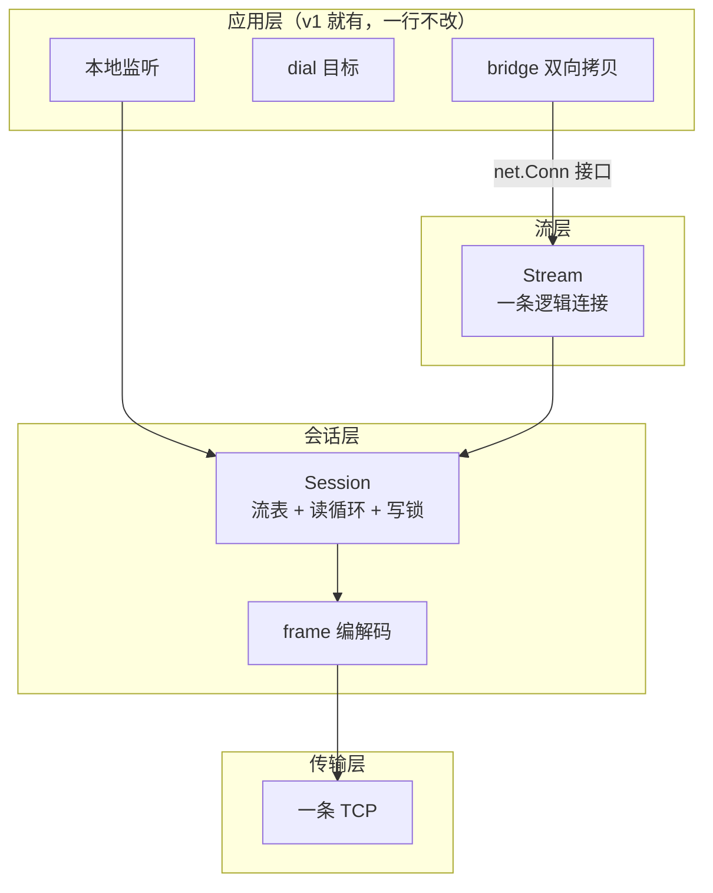
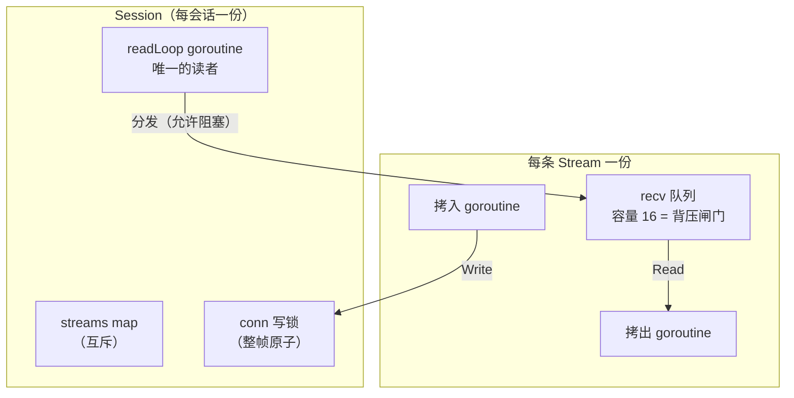
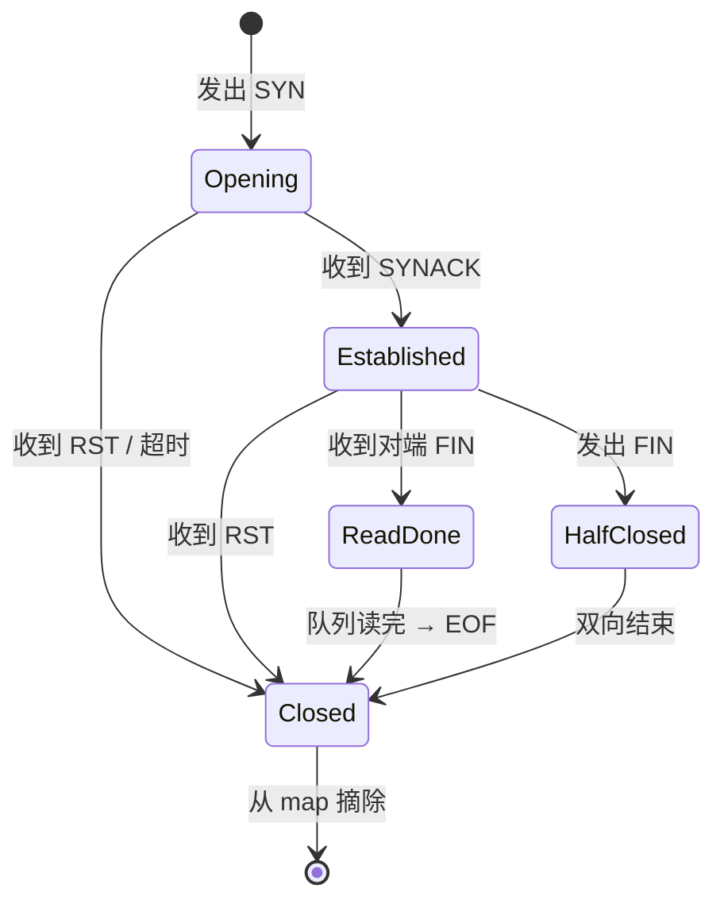

# 把 1000 条 TCP 压成 1 条：一次设计推导的完整记录

> 五张草稿图，记录从一条时间线到一个可运行系统的全过程。

看别人的架构图学不会设计——因为那都是**成品图**：干净、完整、结构正确，是设计完成后画给别人看的。

设计时画的是另一种东西：**草稿**。丑、会改、只有自己看得懂，而且**不是一次画完的**——每画一张，都是因为上一张暴露了问题。

目标只有一个：**把所有转发压到一条 TCP 上**。这篇记录的是从这条约束出发，一个多路复用系统怎么一步步被设计出来——中间留下的五张图是沿途的草稿，不是目的。

<!-- more -->

## 零、起点：只写时间线，不画图

设计的真正起点不是图，是一段**大白话**。

**现状**（v1 已经能跑）：每来一条本地连接，就往服务端新建一条 TCP。

**目标**：全部转发只准用一条 TCP。

于是写下最简单的场景——浏览器发一个请求，用大白话把经过的步骤写下来：

1. 浏览器连 client 的 8080
2. client 看有没有到服务端的路，没有就修一条（**只修一次**）
3. client 在路上说一句："帮我开一条流，号 1，去 8000"
4. server 收到，拨 8000
5. server 回一句："1 号好了"
6. 浏览器的数据 → client 打成"1 号的包" → server 拆开 → 写给 8000
7. 8000 的响应 → 原路打包回来 → 写给浏览器
8. 浏览器说"我发完了" → 一路传到 8000 → 8000 把剩下的响应补发回来 → 全关

没有箭头、没有术语、没有"并发""多路复用"这些词——**这些词是后面才出现的**。

下面五张图，全部出自对这段时间的追问。

## 一、场景视图：时间线里藏着哪些"如果"

对着上面 8 步逐条问"如果…怎么办"，答案就是场景清单：

| 时间线里这一步 | 如果… | 必须保证 |
|---|---|---|
| 4. server 拨 8000 | 拨不通 | 立刻失败，不能让人干等 |
| 8. 浏览器说"我发完了" | 但响应还没回来 | 半关闭：我发完了，你补发的我还要收 |
| 2. 修一条路 | 对端不是自己人 | 立刻认出来，别把 HTTP 当协议读 |
| 6-7. 双向传数据 | 两条流同时传 | 各走各的，不能串 |
| 全程 | 路断了 | 所有流一起收尾，不能挂死 |


这张图不是画出来才有设计的——它是**把刚才那些"如果"落到链路上**，看清每一段各自的风险。

## 二、逻辑视图：谁来负责"复用"

**撞墙**：把第 2 步的 dial 挪出循环之后，两个浏览器的响应字节交错写进同一条连接，服务端收到的是 `aaa…bbb…aaa…`，完全分不清哪段属于谁。

于是回头看时间线里反复出现的词，把它们命名：

| 时间线里的词 | 命名 | 职责 |
|---|---|---|
| "到服务端的路" | `Session` | 一条 TCP + 一张流表 + 一个读循环 |
| "一条流" | `Stream` | 一条逻辑连接 |
| "打成包" | `frame` | 编解码 |

分层就自己长出来了：



**这张图逼出的关键决策**：应用层只依赖 `net.Conn`，不认识 `Stream`。复杂度被关在会话层内部，不外溢——所以 v1 的 `bridge` 一行没改。

## 三、进程视图：谁读、谁写、谁能卡住

**撞墙**：接着写就发现两个硬问题——

- 两个 goroutine 同时读这条 TCP，会把帧读成两半
- 多条流同时写，字节交错，对端解析直接错乱

再看时间线第 6 步："打包 → 传 → 拆包 → 写给 8000"。如果 8000 那边读得慢，包就会堆积——**堆积在哪、堆满了怎么办**，逼出这张图：



三条铁律是这张图的**直接推论**，不是经验：

1. 只有一个读者（两个读者会读乱）
2. 写必须整帧原子（否则交错成半帧）
3. **投递允许阻塞、但绝不能持锁**——阻塞是为了背压，持锁会把整条会话连坐卡死

## 四、行为视图：顺序到底是怎样的

**撞墙**：时间线第 8 步最难——"我发完了"要一路传到 8000，而 8000 补发的响应还要能原路回来。同时第 4 步"拨不通"要立刻回话。这两件事的顺序光靠时间线说不清了，必须画出来：

```mermaid
sequenceDiagram
    participant L as 本地连接
    participant C as client
    participant S as server
    participant T as 目标

    L->>C: 新连接
    C->>S: SYN(id, target)
    alt dial 成功
        S->>C: SYNACK(id)
        C<->>S: DATA(id) 双向
        L->>C: FIN（我发完了）
        C->>S: FIN(id)
        S->>C: DATA(id) 剩余响应
        S->>C: FIN(id)
        Note over C,S: 双向结束 → 从 map 摘除
    else dial 失败
        S->>C: RST(id)
        Note over L: 立刻关闭，不挂死
    end
```

注意 `FIN` 之后还有一段 `DATA`——这正是半关闭的意义：我发完了，但你补发的响应我还要收。

## 五、状态视图：一条流到底有几种状态

**撞墙**：写着写着开始分不清"现在这条流还能不能读、还能不能写"。四个布尔量在脑子里打架的时候，就该画状态图了：



一旦画出来，"什么状态可读、什么状态可写"就变成可查的表，而不是散落在代码里的 `if`。**协议 bug 九成出在状态迁移没覆盖全**。

## 六、回头看：哪些是被逼的，哪些才是选择

五张图画完，回头清点：

| 步骤 | 性质 |
|---|---|
| 把 dial 挪出循环 | 目标 |
| 加 streamID（否则分不清归属） | **被逼** |
| 加长度字段（TCP 没边界） | **被逼** |
| 加 SYN/FIN/RST（开流、半关闭、拒绝） | **被逼** |
| 只留一个读 goroutine | **被逼** |
| 写锁（否则字节交错） | **被逼** |
| 队列设上限（否则内存爆） | **被逼** |
| 结束时从 map 摘掉 | **被逼** |
| **让 Stream 实现 net.Conn** | **选择**（为了上层零改动） |
| **收尾按能力断言而非类型** | **选择**（为了兼容上面那条） |

**十步里只有两步是真正的选择**，其余都是"不这么做就跑不起来"。

这就是设计这件事的真相：它不像在菜单里点菜，更像是被问题推着走——每回答一个问题，结构就长一点，长到最后回头一看，就是那五张图。

## 下次你设计这类场景，照这个顺序

1. **写时间线**（大白话，8 步以内）——不画图
2. **逐条问"如果…怎么办"** → 场景清单
3. **给时间线里反复出现的词命名** → 对象和分层
4. **遇到"谁同时在做"** → 进程图
5. **遇到"顺序说不清"** → 时序图
6. **遇到"状态分不清"** → 状态图

判断标准也很简单：**能用大白话把每个参与者在每个时刻做什么讲一遍，并且答得出每个"如果"，就可以开始写代码了**。讲不出来就回去补时间线——这时候动手，只会写出要推倒重来的东西。

代码在 [example/2026/10/27](https://github.com/yiiewang/yiiewang.github.io/tree/master/example/2026/10/27)，`mux.go` 顶部那三条不变量就是第三张图那三个箭头的文字版。

---

*最后更新：2026-10-28*
